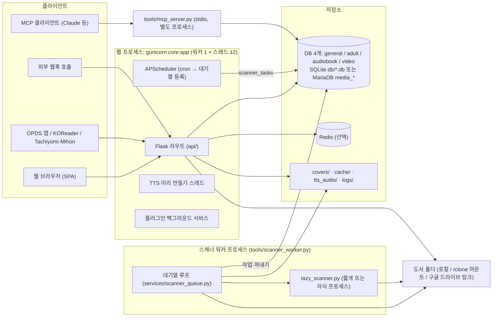
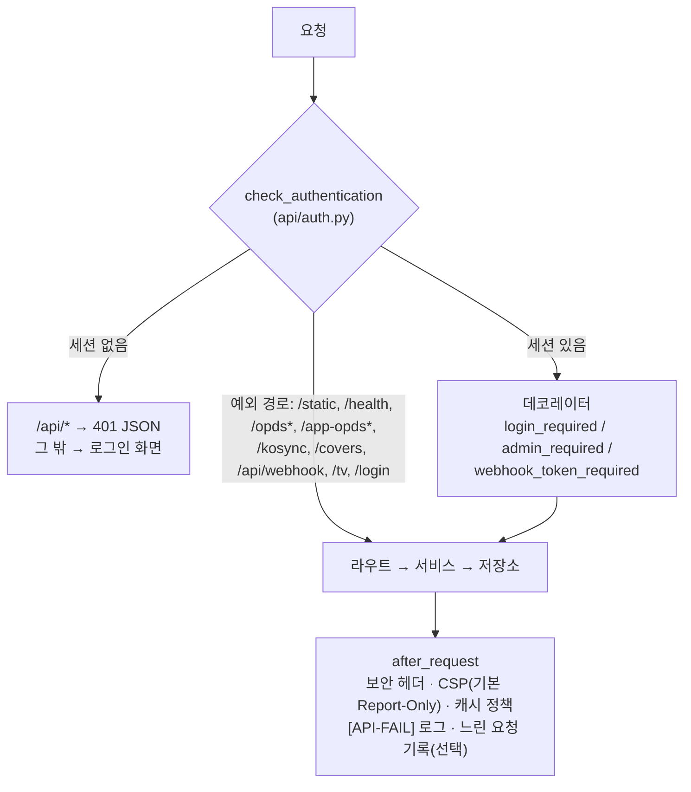
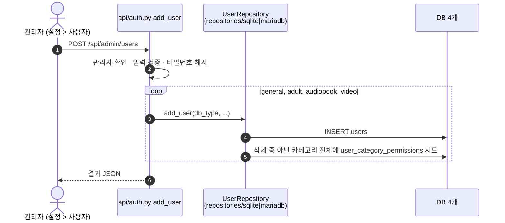
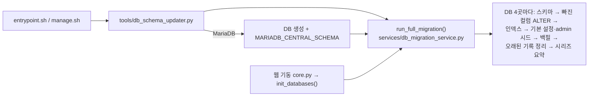
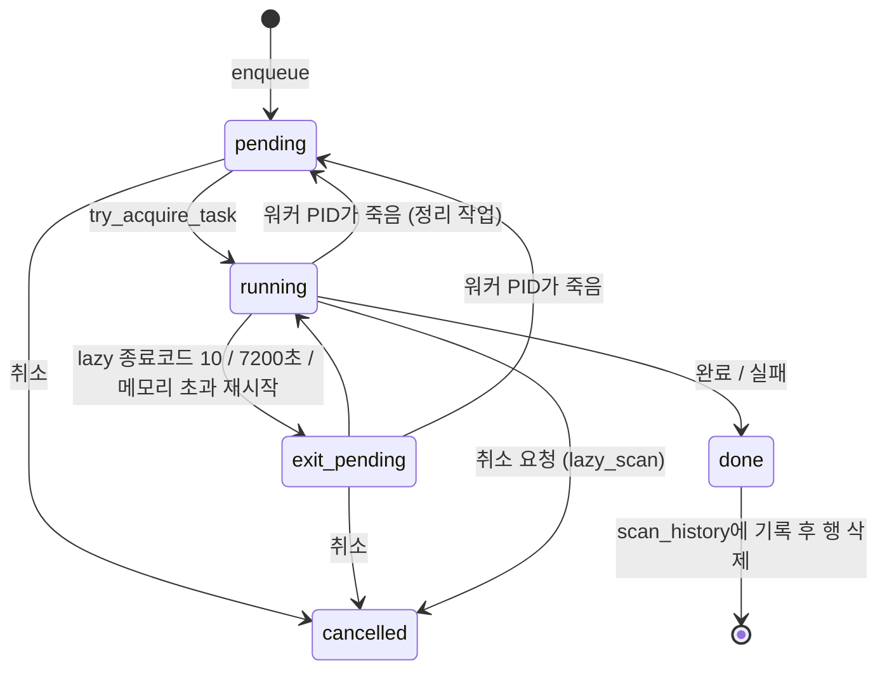
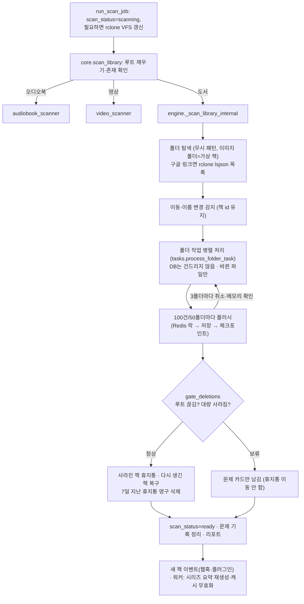
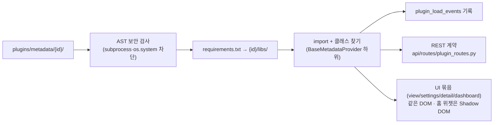
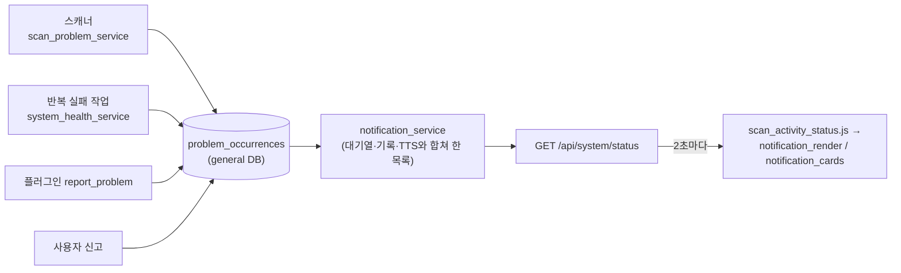

# 🏗️ BookOasis 아키텍처 가이드

BookOasis 소스를 처음 여는 기여자·포크 개발자를 위한 **전체 지도**입니다. 어떤 프로세스가 돌고, 요청과 스캔이 어디로 흐르고, 무엇을 고치려면 어디를 보면 되는지를 설명합니다.
세부 명세(스키마 전체, 스캐너 규칙, 플러그인 계약)는 [§12 관련 문서](#12-관련-문서)로 연결합니다.

* 기준 버전: **3.1.0** (코드와 대조해 작성)
* 경로는 저장소 루트 기준입니다. `파일:줄`은 작성 시점 기준이라 조금 어긋날 수 있습니다.

---

## 1. 한눈에 보기

* **웹 프로세스**는 화면·API·스트리밍을 맡고, 무거운 스캔은 직접 하지 않고 **대기열에 넣기만** 합니다.
* **스캐너 워커**는 대기열(`scanner_tasks` 테이블)에서 작업을 하나씩 꺼내 처리합니다. 두 프로세스는 **DB로만** 상태를 주고받습니다.
* 런타임 밖의 것: `web_service/`(공개 홈페이지), `plugin_data_relay/`·`bo_relay_ss/`(Fly.io에 따로 올리는 중계 서버), `api.py`(예전 래퍼, 쓰지 않음 — 실제는 `api/` 패키지).

---

## 2. 설계 원칙

코드를 고칠 때 먼저 지켜야 하는 전제들입니다.

| 원칙 | 내용 | 코드 |
| :--- | :--- | :--- |
| 코어는 세 가지만 | 코어가 직접 관리하는 것은 **뷰어, 스캐너, 카테고리·권한**뿐입니다. 메타데이터 검색, 위젯, 상세 화면 확장 등은 플러그인 계약으로 뺍니다 | `plugin_framework/metadata_base.py` |
| 코어는 게이트웨이 | 플러그인에는 DB 접근(방언 자동 변환)과 계약만 줍니다. 플러그인의 데이터 형식·로직에 코어가 관여하지 않습니다 | `services/plugin_db_gateway.py` |
| 웹 워커는 하나 | `--workers 1 --threads 12`. 스케줄러 인스턴스, HLS 프로세스 목록, TTS 스레드, 메모리 캐시·락이 **프로세스 하나**를 전제로 합니다. 다중 코어가 필요해지면 `-w N`이 아니라 역할 분리(상태 없는 웹 + 단일 서비스 프로세스 + Redis 공유 상태)로 가야 합니다 | `services/video_hls_service.py`, `services/scheduler_service.py` |
| 프로세스 사이 상태는 DB | 작업 대기열(`scanner_tasks`), 문제 카드(`problem_occurrences`), 목록 변경 신호(`books_epoch`)는 DB에 둡니다. Redis는 **가속기**이고, 없으면 DB·메모리로 대신합니다 | `utils/redis_helper.py` |
| 지우기 전에 의심 | 루트가 끊겼거나 한 번에 많이(20%·20권 이상) 사라지면 휴지통 이동을 보류하고 관리자 확인을 받습니다 | `services/scan_problem_service.py` `gate_deletions` |
| PDF는 격리 | PDF 파서가 프로세스를 죽일 수 있어, PDF는 웹·워커 안에서 열지 않고 `lazy_scanner.py` 자식 프로세스로만 엽니다 | `services/book_scan_service.py` `scan_document_books` |
| 독서를 방해하지 않기 | 처리가 필요한 알림도 토스트·팝업으로 띄우지 않고, 눌러서 들어가는 표시(종 아이콘 점, 카테고리 경고)만 씁니다 | `static/js/scan_activity_status.js` |
| 번들러 없음 | 프런트엔드는 빌드 단계 없는 네이티브 ES 모듈입니다. 캐시는 버전이 들어간 주소로 해결합니다(§9) | `core.py` `module_asset_url` |

---

## 3. 프로세스, 기동과 종료

### 실행 방식 3가지

| | Docker (`entrypoint.sh`) | 네이티브 `manage.sh start` | 직접 `gunicorn core:app` |
| :--- | :--- | :--- | :--- |
| 웹 | `Dockerfile` CMD: `--workers 1 --threads 12 --timeout 300 --graceful-timeout 15` | `-w 1 --threads 12 --max-requests 5000 --max-requests-jitter 500 --timeout 300` | 설치 가이드의 명령 |
| 스캐너 워커 | `/health`가 응답한 뒤 `setsid` 재시작 루프로 `tools/scanner_worker.py` 실행 | `tools/scanner_worker_supervisor.sh`(죽으면 3초 뒤 재시작, `.scanner_worker.stop` 파일이 있으면 멈춤) | 웹이 자식 프로세스로 띄움(내장 워커) |
| 기동 전 | DB 무결성 검사 → 필요하면 `tools/db_recovery.py` → `tools/db_schema_updater.py` | 같음 | 없음(웹 기동 때 마이그레이션은 돔) |

**내장 워커 규칙** (`core.py` `should_enable_embedded_scanner_worker`)
* `BOOKOASIS_ENABLE_EMBEDDED_WORKER`를 true/false로 주면 그대로 따릅니다. 비어 있으면 Docker(`/.dockerenv` 있음)에서는 끄고, 그 밖에서는 켭니다. `manage.sh`는 false로 고정합니다.
* 켜져 있으면 웹이 `BOOKOASIS_IS_WORKER=true`로 워커를 띄우고, 작업을 넣을 때마다 살아 있는지 확인해 다시 띄웁니다.
* 꺼져 있으면 웹은 워커를 띄우지 않고, 20초 뒤 전용 워커가 없으면 🔔 알림에 경고를 올립니다.

### 웹 프로세스 기동 순서
`core.py`는 **import될 때** 앱 전체를 만듭니다(`BOOKOASIS_IS_WORKER=true`면 건너뜀).
1. 로그 설정, 남은 유령 작업 정리
2. Flask 앱 생성, 설정(`SECRET_KEY`, 업로드 한도, CSP), 블루프린트 등록
3. `init_databases()` → `run_full_migration()` (스키마·컬럼 보강·시드, §5)
4. 스케줄러 시작(중단된 스캔 자동 재개 포함)
5. 플러그인 백그라운드 서비스, TTS 미리 만들기 스레드
6. 정책에 따라 내장 스캐너 워커
7. 종료 처리기 등록: Redis 진행도 저장 → 워커·lazy 스캐너 종료 → 스케줄러 정지 → DB 풀 닫기

### 종료 순서 (바꾸지 말 것)
**스캐너 → lazy 스캐너 → 웹** 순서로 멈춥니다(`entrypoint.sh` `cleanup`, `manage.sh stop`). 웹이 DB 풀을 닫고 WAL 체크포인트를 하는 동안 스캐너가 쓰고 있으면 SQLite가 손상될 수 있기 때문입니다.
스캐너 워커(`tools/scanner_worker.py`)는 종료 신호 처리기가 없어 SIGTERM에 바로 끝나고, **다음 기동 때 이어 하기**로 복구합니다. 실행 중이던 작업은 `scanner_tasks`에 `running`으로 남고, 다음 기동 때 `startup_cleanup_ghost_tasks()`가 `pending`으로 되돌려 이어서 합니다(이미 저장된 폴더는 mtime으로 건너뜀). 엔진의 `stop_requested`로 "멈추고 마무리"하게 바꾸면 남은 폴더를 두고 작업이 '완료'로 기록되어 이어 하기가 사라집니다.
`gunicorn.conf.py`의 `worker_exit`는 rclone 마운트 읽기에 묶인 스레드 때문에 워커 재시작이 멈추지 않도록, 정리 뒤 바로 프로세스를 끝냅니다.

---

## 4. 웹 요청 계층

### 블루프린트 구조
모든 라우트는 `api/__init__.py`의 `api_bp` 아래에 등록됩니다. **`url_prefix`는 쓰지 않고** 각 모듈이 전체 경로를 적습니다.

| 묶음 | 모듈 | 내용 |
| :--- | :--- | :--- |
| `api/library.py` (묶음) | `api/routes/media_library_routes.py`, `book_routes.py`, `plugin_routes.py` | 목록·검색·상세, 도서 편집, 플러그인 계약 API |
| `api/admin.py` (묶음) | `library_routes`, `scan_routes`, `browse_routes`, `settings_routes`, `report_routes`, `system_routes`, `permission_routes`, `trash_routes`, `tv_routes`, `gdrive_copy_routes`, `gdrive_view_copy_routes` | 카테고리·스캔·설정·권한·휴지통·알림 상태 |
| 단독 | `api/stream.py`, `api/opds.py`, `api/app_opds.py`, `api/auth.py`, `api/dashboard_insights.py`, `api/routes/{audiobook,video,collection,annotation,bookmark,kosync,plugin_webview,tts,problem,experimental}_routes.py` | 스트리밍, OPDS, 로그인·사용자, 미디어별 API |

> `api/admin.py`·`api/library.py`는 **파일을 묶는 용도**일 뿐 권한 경계가 아닙니다. 권한은 각 라우트의 데코레이터가 정합니다.

### 요청 한 건의 흐름

* 인증은 Flask 서명 쿠키 세션입니다. 로그인 때 역할(`admin`/그 밖)과 미디어별 접근 권한, 콘텐츠 등급 상한을 세션에 넣습니다.
* OPDS·App-OPDS는 HTTP Basic, kosync는 `x-auth-user`/`x-auth-key` 헤더, 웹훅은 `WEBHOOK_TOKEN`으로 따로 인증합니다.
* 쓰기 요청(`POST/PUT/PATCH/DELETE`)이 실패하면 `logs/media_server.log`에 `[API-FAIL]` 한 줄이 남습니다(`utils/request_failure_log.py`). 느린 요청 기록은 `DEBUG_REQUEST_LOG=true`일 때만 `logs/request_debug.log`에 남습니다.

### 계층: 원칙과 실제
원칙은 **라우트(검증) → 서비스(업무 흐름) → 저장소(SQL)** 입니다.
* **저장소 선택 방식**: `repositories/__init__.py`가 시작할 때 `DB_ENGINE`을 보고 `repositories/sqlite/*` 또는 `repositories/mariadb/*`를 `repositories.<이름>`으로 연결합니다. 그래서 `from repositories.user_repository import UserRepository`는 **실제 파일이 없어도** 동작합니다. 같은 이름의 모듈이 두 폴더에 26쌍 있고, 방언 차이가 없는 공용 코드는 `repositories/*_shared.py` 등에 있습니다.
* **실제 예외**: 사용자 관리(`api/auth.py`)처럼 라우트가 저장소를 바로 부르는 곳이 꽤 있고, `api/routes/scan_routes.py`에는 라우트 안 SQL이 몇 줄 있습니다.
* **새 코드는**: SQL은 저장소에, 여러 저장소를 엮는 흐름은 서비스에 두세요. 라우트는 입력 검증과 응답 모양만 맡습니다.

### 어느 DB를 쓸지 (`db_type`)
서버 세션에 "현재 서재"는 없습니다. 클라이언트가 **요청마다** `?type=`(일부는 `db_type`, 폼·JSON 필드, URL 일부)으로 `general`/`adult`/`audiobook`/`video`를 보내고, 없으면 `general`입니다. 프런트는 `state.currentLibraryType`에 들고 있습니다. 성인·오디오북·영상 접근은 `check_adult_permission(db_type)`으로 확인합니다.

### 예: 사용자 추가

사용자는 **DB 4곳 모두에** 같은 사용자명으로 만들어지고, 로그인은 `general`에서 확인합니다. 삭제·비밀번호 변경도 4곳을 돕니다.

---

## 5. 데이터 계층

### DB 4개
| db_type | SQLite | MariaDB | 담는 것 |
| :--- | :--- | :--- | :--- |
| `general` | `db/media_general.db` | `media_general` | 일반 도서 + **전역 데이터**: `settings`, `scanner_tasks`, `scan_history`, `problem_occurrences`, 로그인 계정 |
| `adult` | `db/media_adult.db` | `media_adult` | 성인 도서 |
| `audiobook` | `db/media_audiobook.db` | `media_audiobook` | 오디오북·음악, 트랙, 청취 진행도 |
| `video` | `db/media_video.db` | `media_video` | 영상 강좌, 회차, 시청 진행도 |

* 4곳 모두 같은 스키마로 만들어지고, 쓰는 테이블만 다릅니다. `users`·`user_category_permissions`는 DB마다 있습니다.
* MariaDB DB 이름은 `MARIADB_DATABASE_PREFIX`(기본 `media_`) + db_type입니다.

### 연결 쓰는 법
* **`with database.connection(db_type) as conn:`** 을 쓰세요. 블록이 끝나면 풀에 반납됩니다. `get_connection()`을 쓰면 반드시 `close()`해야 합니다.
* 반납을 잊어 가비지 컬렉션된 연결은 다음 요청 때 슬롯을 자동 회수합니다(안전망일 뿐, 의존하지 말 것).
* MariaDB 연결은 SQLite식 SQL을 자동 변환하는 래퍼를 거칩니다(`?`→`%s`, `INSERT OR IGNORE`, `datetime('now')` 등, `database.py` `MariadbCursorWrapper`). 그래도 방언이 크게 다른 쿼리는 저장소 두 벌에 따로 씁니다.
* SQLite는 WAL 모드입니다. 스캐너 플러시 뒤 PASSIVE, 종료·기동 때 TRUNCATE 체크포인트를 합니다.

### 스키마와 마이그레이션

* SQLite DDL은 `_SCHEMA_SQL`·`_INDEXES_SQL`(`services/db_migration_service.py`), MariaDB DDL은 `MARIADB_CENTRAL_SCHEMA`(`tools/db_schema_updater.py`) **두 곳**에 있습니다. 새 테이블·컬럼은 둘 다 고쳐야 합니다 → [change_db_guide.md](./change_db_guide.md)
* 빠진 컬럼은 기동 때 자동으로 `ALTER TABLE ADD COLUMN` 됩니다. 마이그레이션은 매 기동 돌아도 안전해야 합니다(멱등).
* 테이블 사이 외래 키·연쇄 삭제는 없습니다. 도서에 딸린 데이터 정리는 코드가 목록으로 합니다(§11).

### Redis (선택)
`REDIS_URL`이 있을 때만 씁니다. 모든 키에 `bookoasis:` 접두어가 붙고, 연결이 안 되면 30초 동안 쓰지 않고 대체 경로로 갑니다.

| 키 | 용도 | Redis가 없으면 |
| :--- | :--- | :--- |
| `user:progress:*`, `sync:progress:pending` | 읽은 위치를 모았다가 DB에 주기적으로 저장(기본 2초) | 메모리 버퍼 + 저장 스레드 |
| `lock:db_write:<db>` | 진행도 저장·스캐너 플러시·대기열 결과 기록이 겹치지 않게 | 항상 통과(SQLite 잠금에 맡김) |
| `queue:scanner` | 워커가 새 작업을 바로 깨어 받기(`BRPOP`). 진짜 대기열은 DB | DB를 3초마다 확인 |
| `cache:history*`, `cache:recent_added*`, `cache:smart_rec*` | 홈 목록 캐시(1시간) | 매번 조회 |
| `cache:books_epoch:<db>` | "도서 목록이 바뀜" 신호(프로세스 사이) | `settings` 테이블 값 |
| `plugin:<id>:<key>` | 플러그인 캐시 | 동작 안 함(no-op) |

### 파일 저장 위치
| 위치 | 내용 |
| :--- | :--- |
| `db/` | SQLite 파일, 스캔 중 임시 JSONL |
| `covers/` (설정 `COVER_STORAGE_ROOT`로 변경 가능) | 표지 WebP, `covers/<library_id>/` |
| `cache/` | 구글 드라이브 내려받기 캐시, `gdrive_meta/`(링크 카테고리 메타 미러), `gdrive_view/`, `hls/`, `epub_images/`, `tts_models/`, `reports/`(스캔 에러 리포트) |
| `tts_audio/` (`TTS_AUDIO_ROOT`) | 서버에서 미리 만든 TTS 음성 |
| `logs/` | `media_server.log`, `scanner.log`, `lazy_scanner.log`, `scan_history.log`, `request_debug.log` 등 |

---

## 6. 스캐너 파이프라인

### 작업이 들어오는 곳
| 출처 | 작업 종류 |
| :--- | :--- |
| 카테고리 스캔 버튼, 전체 스캔, 카테고리 추가·수정 | `library_scan` |
| 카테고리별 cron(스케줄 탭) · 중단된 스캔 자동 재개 | `library_scan` (`services/scheduler_service.py`) |
| 웹훅 `/api/webhook/scan` (path 없음) | `library_scan` |
| 표지 스캔 | `cover_scan` |
| 도서·선택·시리즈 단위 재스캔 | `lazy_scan`, `batch_book_scan` |
| `LAZY_SCAN_CRON`(기본 매일 03:00) | `lazy_scan` |
| 카테고리 삭제 / 일반↔성인 이동 | `library_delete`, `library_transfer` |
| 구글 드라이브 복사 | `gdrive_copy` |

**대기열을 거치지 않는 즉시 스캔**: 폴더 지정 스캔(`/scan-path`), path를 준 웹훅, 플러그인 웹뷰 다운로드는 웹 프로세스 안에서 그 폴더만 바로 스캔하고, 바뀐 시리즈만 요약을 갱신합니다(`services/scan_refresh_service.py`).

### 대기열과 워커
* 작업은 `scanner_tasks`(general DB)에 들어가고, 같은 키의 작업이 이미 있으면 다시 넣지 않습니다.
* 워커는 **한 번에 하나만** 실행합니다(`try_acquire_task`). 순서: `exit_pending` → lazy가 아닌 작업 → lazy, 그 안에서 먼저 들어온 순서.
* 끝난 작업은 결과를 `scan_history`에 남기고 **`scanner_tasks`에서 지웁니다**.

### 카테고리 스캔 한 번

* 폴더 작업은 DB를 건드리지 않고 결과만 돌려주며, 쓰기는 플러시 한 곳에서만 합니다.
* 메모리가 한도를 넘으면 저장 후 `exit_pending`으로 표시하고 워커가 자기 자신을 다시 실행해 이어 갑니다.
* 스캔은 중간에 끊겨도 폴더 체크포인트(`scanner_progress`)에서 이어집니다.

### lazy 스캐너와 PDF 격리
* `tools/lazy_scanner.py`는 항상 **자식 프로세스**입니다. 표지가 없거나 실패한 책, 페이지 위치(오프셋)가 없는 ZIP을 채우고, 영상 길이 보강·표지 크기 정리도 합니다.
* 종료 코드 **10** = "더 할 일 있음"(배치·메모리 한도) → 우선순위 작업이 있으면 양보하고 다시 실행, **0** = 끝.
* PDF 표지·쪽수는 웹이나 워커에서 열지 않고 `lazy_scanner.py --book-ids … --force-document-covers` 자식 프로세스로만 처리합니다.

### 오디오북·영상 스캐너
`services/audiobook_scanner.py`, `services/video_scanner.py`는 폴더 하나 = 책(강좌) 하나로 보는 단순한 단일 스레드 스캐너입니다. 파일 목록 서명이 바뀐 폴더만 다시 처리합니다. 도서 스캐너의 체크포인트·Redis 락·삭제 보류 장치는 없습니다.

### 구글 드라이브 링크 카테고리 (클로즈 베타)
`GDRIVE_LINK_BETA=true`일 때만 만들 수 있습니다. 책 경로는 `gdrive:/<폴더ID>/…` 가상 경로이고, 목록은 `rclone lsjson`, 메타데이터는 `cache/gdrive_meta/` 미러로 읽습니다.

---

## 7. 확장 지점

### 플러그인

* 계약의 기준은 `plugin_framework/metadata_base.py`(필수 `search`/`apply` + 선택 위젯·메뉴·훅·문제 카드)입니다. 계약 버전과 목록은 [guide_plugins.md](./guide_plugins.md)에 있습니다.
* 플러그인 JS는 iframe이 아니라 **앱과 같은 페이지**에서 돕니다(카테고리 탭·상세 화면은 `new Function`, 홈 위젯은 Shadow DOM).
* 보안: `admin_only`(관리자 외 전부 숨김), subprocess 사용 차단(샌드박스는 아님 — 신뢰할 수 있는 플러그인만 설치), 외부 주소 요청은 `services/ssrf_guard.py`, 웹뷰는 관리자가 허용한 도메인만.
* 플러그인이 DB를 쓰려면 `self.get_db_gateway(db_type)`. 코어 테이블 구조에 기대는 플러그인은 [change_db_guide.md](./change_db_guide.md)의 변경 공지를 따라가야 합니다.

### 알림센터와 문제 카드

같은 원인은 `문제 종류 × 카테고리` 카드 한 장으로 묶이고, 다음 스캔에서 정상이면 저절로 풀립니다. 설계: [plan_unified_notification_queue.md](./plan_unified_notification_queue.md), 사용법: [guide_admin.md](./guide_admin.md) §11.

### 외부 인터페이스
| 인터페이스 | 진입점 | 인증 |
| :--- | :--- | :--- |
| OPDS (`/opds`, `/opds-adult`, 만화 페이지 스트리밍) | `api/opds.py`, `api/opds_common/` | HTTP Basic |
| App-OPDS (Tachiyomi/Mihon, `/app-opds*`) | `api/app_opds.py`, `services/app_opds_viewer_service.py` | HTTP Basic (5분 캐시) |
| KOReader 진행 동기화 (`/kosync/*`) | `api/routes/kosync_routes.py`, `services/kosync_service.py` | 동기화 전용 비밀번호 |
| 들어오는 웹훅 (`/api/webhook/scan` 등) | `api/routes/system_routes.py` | `WEBHOOK_TOKEN` |
| 나가는 웹훅 (Discord/Slack/Telegram, `book.new/read/finish`) | `services/webhook_dispatcher.py` | HMAC 서명(`WEBHOOK_EVENT_SECRET`) |
| MCP (진단·읽기 + 승인형 쓰기) | `tools/mcp_server.py` (stdio) | 로컬 프로세스·SSH |
| TV 화면 (`/tv`) | `api/routes/tv_routes.py` | 화면 안 로그인 |

---

## 8. 미디어와 뷰어

* **만화(ZIP/CBZ/이미지 폴더)**: `services/stream_page_service.py`가 메모리 캐시 → Redis → **스캔 때 저장한 오프셋으로 그 항목만 읽기**(구글 링크는 HTTP Range) → `zipfile` 순으로 페이지를 꺼냅니다. 다음 4쪽은 미리 읽습니다.
* **EPUB**: epub.js를 쓰지 않습니다. 서버가 장 단위로 파싱·정리(허용 태그만)해서 보내고(`services/text_epub_content_service.py`, `api/stream.py`), 브라우저는 `static/js/viewer_txt.js`로 TXT와 같은 방식으로 그립니다.
* **PDF**: `static/lib/pdfjs-6.4.299/`를 PDF를 열 때만 불러옵니다(`static/js/utils/script_loader.js`).
* **오디오북·음악**: `api/routes/audiobook_routes.py`(브라우저가 못 여는 형식은 ffmpeg 변환), 플레이어는 `static/js/audio_player_modules/`.
* **영상**: `api/routes/video_routes.py`가 필요할 때 ffmpeg(VAAPI 있으면 사용)로 변환하고, Safari/iOS에는 `services/video_hls_service.py`가 HLS 조각을 만들어 줍니다.
* **TTS**: 기본은 브라우저 안에서 합성(`static/js/tts/`, Supertonic 모델). 선택으로 서버가 미리 만들어 둘 수 있습니다(`services/tts_pregen_service.py`, `TTS_PREGEN_ENABLED`).

---

## 9. 프런트엔드

* **셸**: `templates/index.html` → `templates/components/tab_media_library.html` → 진입 모듈 `static/js/tab_media_library.js`. 화면 조각은 `templates/components/`(views, modals, settings 탭)에 있습니다.
* **핵심 모듈**: `state.js`(공유 상태 하나), `api.js`(`safeFetch`, 401이면 로그인으로), `view_manager.js`(화면 전환은 여기로만), `modal.js`, `ui.js`.
* **나중에 불러오기**: 뷰어·상세·설정·플레이어는 처음 쓸 때 `static/js/utils/lazy_module.js`로 불러옵니다.
* **캐시와 버전 주소**: 모듈은 `/static/m/<서명>/js/…`로 내려갑니다. 서명은 `static/js` 전체 파일의 경로·크기·수정 시각으로 만들고, 상대 import가 같은 서명을 이어받아 1년 캐시(immutable)가 됩니다(`core.py` `module_asset_url`, `static_cache_policy`). CSS와 일반 스크립트는 `?v=<버전>&asset=<내용 해시>`를 붙입니다.
  * **진입 모듈에 `?v=`를 붙이지 마세요.** 같은 모듈이 두 번 실행됩니다(`tests/test_module_entry_single_instance.mjs`가 막음).
* **다국어**: `static/i18n/ko.json`, `en.json`. HTML은 `data-i18n`, JS는 `i18n.t()`, 서버는 `utils/i18n.py`의 `_t`(언어 쿠키 `bookoasis_lang`).
* **테마**: 기본 테마는 `static/css/style.css`의 `[data-app-theme=…]`, 사용자 테마는 `themes/*.yaml`(색 변수). 글자·여백은 `--app-fs-*`, `--app-fw-*`, `--app-lh-*`, `--app-space-*` 토큰을 쓰세요 — 포크·테마가 쉽게 바꿀 수 있도록 색과 크기를 하드코딩하지 않는 것이 원칙입니다.

---

## 10. 테스트

| 종류 | 위치 | 실행 (저장소 루트에서) |
| :--- | :--- | :--- |
| Python | `tests/*.py` | `python -m pytest tests` |
| JS (node 내장 테스트) | `tests/*.mjs` | `node --test tests/*.mjs` |

* 테스트는 저장소 루트를 import 기준으로 씁니다(설정 파일 없음). 루트에서 실행하세요.
* `test/`(단수)는 샘플 파일·임시 스크립트 모음이고, 유지되는 테스트는 `tests/`입니다.

---

## 11. 고칠 때 어디를 보나

| 하려는 것 | 같이 고칠 곳 |
| :--- | :--- |
| DB 컬럼·테이블 추가 | `_SCHEMA_SQL`(SQLite) **와** `MARIADB_CENTRAL_SCHEMA`(MariaDB), 필요하면 인덱스 두 곳. [change_db_guide.md](./change_db_guide.md) |
| 도서에 딸린 새 테이블 | 정리 목록 **세 곳**: `repositories/category_data_shared.py`(카테고리 삭제·이동), `repositories/trash_repository_shared.py`(휴지통 비우기), `tools/scanner/sync_detector.py`(7일 자동 삭제) |
| 새 SQL | `repositories/sqlite/`와 `repositories/mariadb/`의 같은 이름 모듈 둘 다 |
| 새 API 라우트 | 블루프린트를 `api/__init__.py`(또는 `api/admin.py`·`api/library.py` 묶음)에 등록, 권한 데코레이터 |
| 새 화면 문구 | `static/i18n/ko.json`과 `en.json` 둘 다 (`tests/test_i18n_keys.py`) |
| 새 JS 모듈 | 상대 경로 import, `?v=` 붙이지 않기 |
| 새 문제 카드 종류 | `services/problem_service.py`의 `CATALOG` + i18n `problems.code.*` |
| 새 스캔 작업 종류 | `services/scanner_queue.py`(작업 키·처리 함수 분기), 알림 표시는 `services/notification_service.py` |
| 새 배경 작업 | 실패를 `SystemHealthService.track`으로 감싸 🔔에 보이게 |
| 플러그인이 쓸 새 기능 | 코어에 넣기 전에 플러그인 계약으로 줄 수 있는지 먼저(§2) |

---

## 12. 관련 문서

| 문서 | 내용 |
| :--- | :--- |
| [spec_db_schema.md](./spec_db_schema.md) | 테이블 명세 |
| [change_db_guide.md](./change_db_guide.md) | DB 스키마를 바꾸는 절차 |
| [spec_scanner_logic.md](./spec_scanner_logic.md) | 스캐너 세부 규칙 |
| [spec_scanner_queue_state_transitions.md](./spec_scanner_queue_state_transitions.md) | 스캔 대기열 상태 |
| [guide_plugins.md](./guide_plugins.md) | 플러그인 계약·호환표·예제 |
| [api_endpoints.md](./api_endpoints.md) | REST API 목록 |
| [plan_unified_notification_queue.md](./plan_unified_notification_queue.md) | 알림센터 설계 |
| [guide_admin.md](./guide_admin.md) | 관리자 기능 |
| [guide_installation.md](./guide_installation.md) | 설치·실행 |
| [guide_mcp_server.md](./guide_mcp_server.md) | MCP 서버 |
| [guide_opds.md](./guide_opds.md) | OPDS·KOReader |
