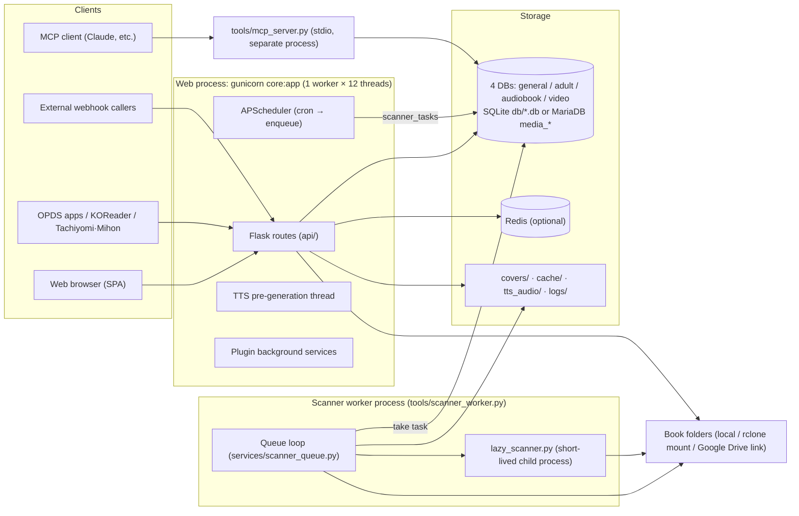
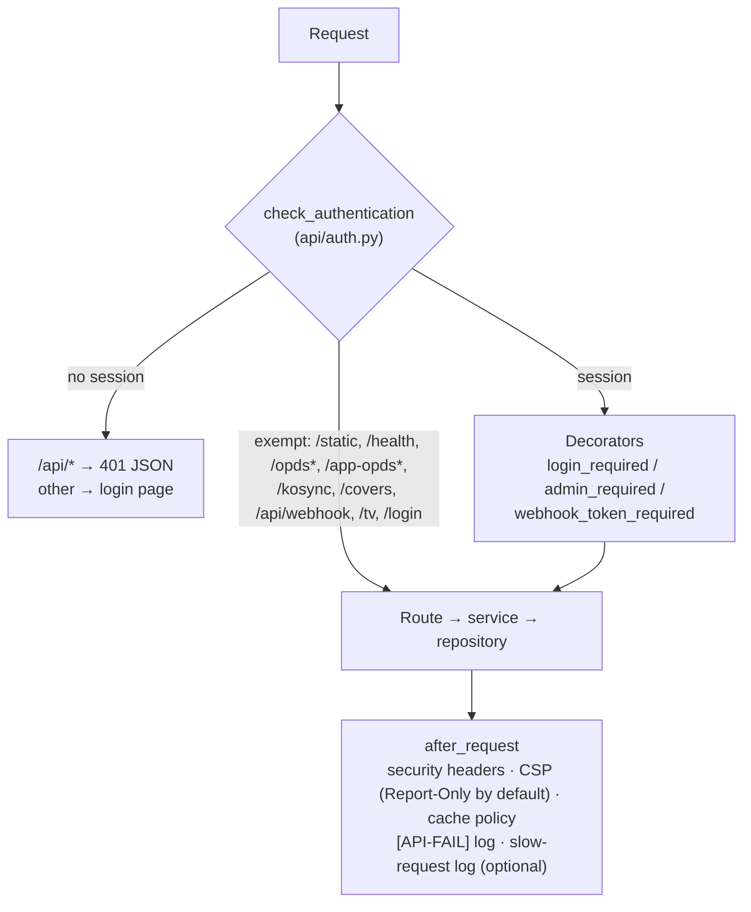
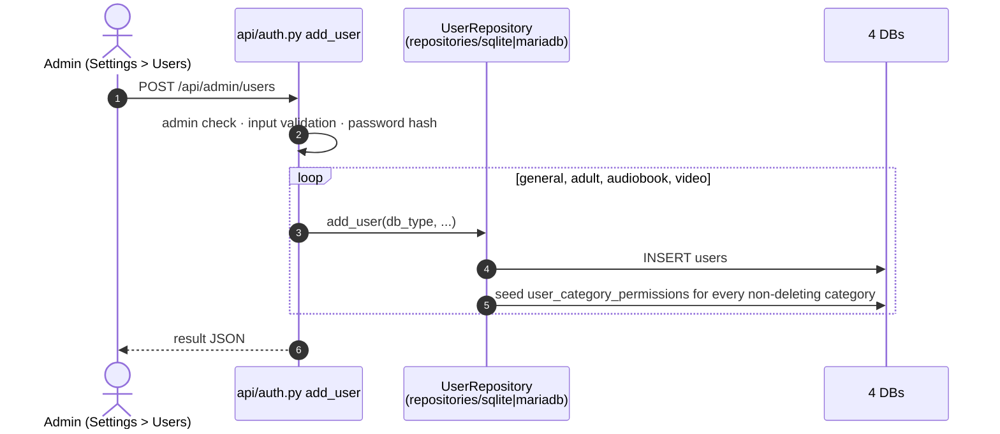
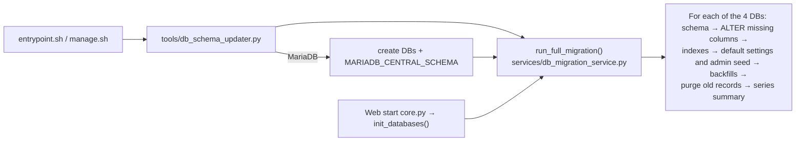
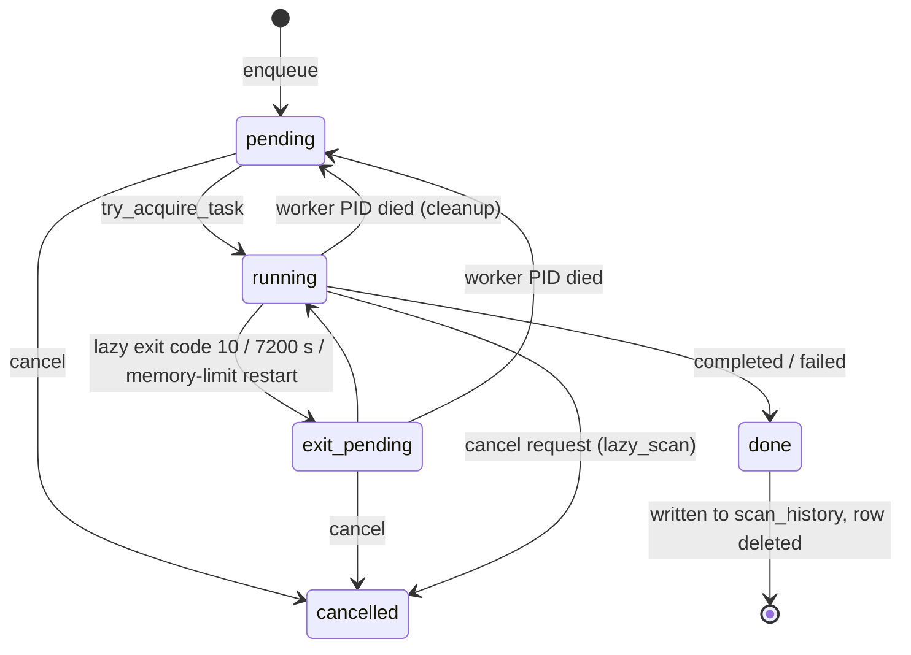
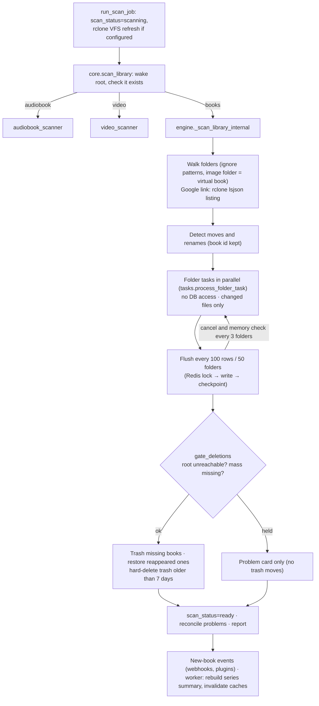
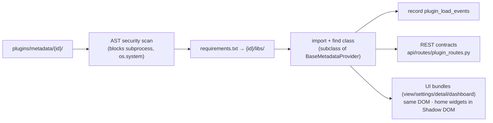
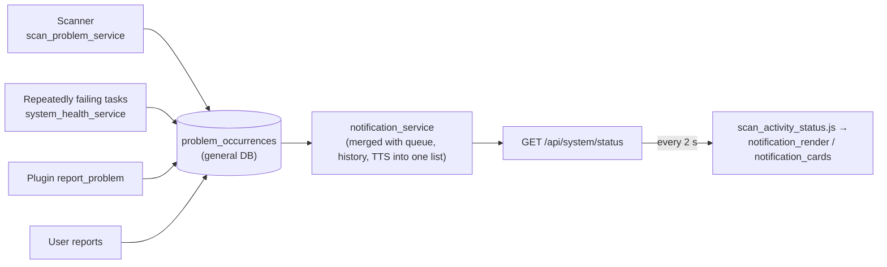

# 🏗️ BookOasis Architecture Guide

This is the **overall map** for contributors and fork developers opening the BookOasis source for the first time. It explains which processes run, where requests and scans flow, and where to look when you want to change something.
Detailed specs (the full schema, scanner rules, plugin contracts) are linked from [§12 Related documents](#12-related-documents).

* Baseline version: **3.1.0** (written against the code)
* Paths are relative to the repository root. `file:line` references were correct when written and may drift a little.

---

## 1. At a glance

* The **web process** handles screens, the API and streaming. It never runs heavy scans itself; it **only enqueues** them.
* The **scanner worker** takes tasks one at a time from the queue (the `scanner_tasks` table). The two processes share state **only through the DB**.
* Outside the runtime: `web_service/` (public website), `plugin_data_relay/` and `bo_relay_ss/` (relay servers deployed separately on Fly.io), `api.py` (old wrapper, unused — the real code is the `api/` package).

---

## 2. Design principles

The assumptions to respect before changing code.

| Principle | What it means | Code |
| :--- | :--- | :--- |
| Core owns three things | The core directly manages only the **viewer, the scanner, and categories/permissions**. Metadata search, widgets, detail-page extensions and so on go through plugin contracts | `plugin_framework/metadata_base.py` |
| Core is a gateway | Plugins get DB access (with automatic dialect translation) and contracts. The core doesn't get involved in a plugin's data formats or logic | `services/plugin_db_gateway.py` |
| One web worker | `--workers 1 --threads 12`. The scheduler instance, the HLS process map, the TTS thread and in-memory caches/locks all assume **a single process**. If multi-core is ever needed, the answer is role separation (stateless web + one service process + shared state in Redis), not `-w N` | `services/video_hls_service.py`, `services/scheduler_service.py` |
| Cross-process state lives in the DB | The task queue (`scanner_tasks`), problem cards (`problem_occurrences`) and the "list changed" signal (`books_epoch`) live in the DB. Redis is an **accelerator**; without it, the DB and memory take over | `utils/redis_helper.py` |
| Doubt before deleting | If a root is unreachable or many books vanish at once (20% and 20+ books), trash moves are held until an admin confirms | `services/scan_problem_service.py` `gate_deletions` |
| Isolate PDFs | A PDF parser can crash a process, so PDFs are never opened inside the web or worker process — only in a `lazy_scanner.py` child | `services/book_scan_service.py` `scan_document_books` |
| Never interrupt reading | Even alerts that need action are never toasts or popups; only marks you click into (the bell dot, the category warning) | `static/js/scan_activity_status.js` |
| No bundler | The frontend is native ES modules with no build step. Caching is solved with versioned URLs (§9) | `core.py` `module_asset_url` |

---

## 3. Processes, startup and shutdown

### Three ways to run

| | Docker (`entrypoint.sh`) | Native `manage.sh start` | Plain `gunicorn core:app` |
| :--- | :--- | :--- | :--- |
| Web | `Dockerfile` CMD: `--workers 1 --threads 12 --timeout 300 --graceful-timeout 15` | `-w 1 --threads 12 --max-requests 5000 --max-requests-jitter 500 --timeout 300` | The command in the installation guide |
| Scanner worker | After `/health` answers, a `setsid` restart loop runs `tools/scanner_worker.py` | `tools/scanner_worker_supervisor.sh` (restarts it 3 s after it dies; stops if `.scanner_worker.stop` exists) | The web process spawns it as a child (embedded worker) |
| Before start | DB integrity check → `tools/db_recovery.py` if needed → `tools/db_schema_updater.py` | Same | None (migrations still run when the web process starts) |

**Embedded worker rules** (`core.py` `should_enable_embedded_scanner_worker`)
* An explicit true/false in `BOOKOASIS_ENABLE_EMBEDDED_WORKER` wins. If unset, it is off in Docker (`/.dockerenv` exists) and on elsewhere. `manage.sh` forces it to false.
* When on, the web process spawns the worker with `BOOKOASIS_IS_WORKER=true` and respawns it whenever a task is enqueued and the worker is gone.
* When off, the web process never spawns a worker; after 20 s, if no dedicated worker is running, it posts a warning to the 🔔 notifications.

### Web process startup order
`core.py` builds the whole app **at import time** (skipped when `BOOKOASIS_IS_WORKER=true`).
1. Logging, cleanup of leftover ghost tasks
2. Flask app creation, config (`SECRET_KEY`, upload limit, CSP), blueprint registration
3. `init_databases()` → `run_full_migration()` (schema, missing columns, seeds; §5)
4. Scheduler start (including auto-resume of interrupted scans)
5. Plugin background services, the TTS pre-generation thread
6. The embedded scanner worker, if the policy allows
7. Shutdown handler: flush Redis progress → stop worker and lazy scanner → stop scheduler → close DB pools

### Shutdown order (do not change)
Stop **scanner → lazy scanner → web** (`entrypoint.sh` `cleanup`, `manage.sh stop`). If the web process closes the DB pools and runs the WAL checkpoint while a scanner is still writing, SQLite can be corrupted.
The scanner worker (`tools/scanner_worker.py`) has no shutdown signal handler, so SIGTERM ends it at once and it **recovers by resuming on the next start**. A running task stays `running` in `scanner_tasks`; on the next start `startup_cleanup_ghost_tasks()` puts it back to `pending` and it resumes (folders already saved are skipped by mtime). Making it "stop and wrap up" through the engine's `stop_requested` would record the task as completed with folders left over, and the resume would be lost.
`worker_exit` in `gunicorn.conf.py` ends the process right after cleanup, so a thread stuck on an rclone mount read can't block worker recycling.

---

## 4. Web request layer

### Blueprint layout
Every route is registered under `api_bp` in `api/__init__.py`. **No `url_prefix` is used**; each module writes full paths.

| Group | Modules | Contents |
| :--- | :--- | :--- |
| `api/library.py` (container) | `api/routes/media_library_routes.py`, `book_routes.py`, `plugin_routes.py` | Lists, search, detail, book editing, plugin contract APIs |
| `api/admin.py` (container) | `library_routes`, `scan_routes`, `browse_routes`, `settings_routes`, `report_routes`, `system_routes`, `permission_routes`, `trash_routes`, `tv_routes`, `gdrive_copy_routes`, `gdrive_view_copy_routes` | Categories, scans, settings, permissions, trash, notification status |
| Standalone | `api/stream.py`, `api/opds.py`, `api/app_opds.py`, `api/auth.py`, `api/dashboard_insights.py`, `api/routes/{audiobook,video,collection,annotation,bookmark,kosync,plugin_webview,tts,problem,experimental}_routes.py` | Streaming, OPDS, login and users, per-media APIs |

> `api/admin.py` and `api/library.py` only **group files**; they are not access boundaries. Each route's decorator decides access.

### One request

* Auth uses Flask's signed cookie session. At login the role (`admin`/other), per-media access flags and the content-rating cap go into the session.
* OPDS and App-OPDS use HTTP Basic, kosync uses the `x-auth-user`/`x-auth-key` headers, and webhooks use `WEBHOOK_TOKEN`.
* When a write request (`POST/PUT/PATCH/DELETE`) fails, one `[API-FAIL]` line goes to `logs/media_server.log` (`utils/request_failure_log.py`). The slow-request log is written to `logs/request_debug.log` only when `DEBUG_REQUEST_LOG=true`.

### Layering: the rule and the reality
The rule is **route (validation) → service (workflow) → repository (SQL)**.
* **How repositories are picked**: at startup `repositories/__init__.py` reads `DB_ENGINE` and maps `repositories/sqlite/*` or `repositories/mariadb/*` onto `repositories.<name>`. That's why `from repositories.user_repository import UserRepository` works **even though no such file exists**. There are 26 same-named module pairs in the two folders; dialect-neutral shared code lives in `repositories/*_shared.py` and similar modules.
* **Real exceptions**: quite a few routes call repositories directly, such as user management in `api/auth.py`, and `api/routes/scan_routes.py` contains a few lines of SQL.
* **New code should** put SQL in repositories and multi-repository workflows in services. Routes only validate input and shape responses.

### Which DB (`db_type`)
There is no "current library" in the server session. The client sends `general`/`adult`/`audiobook`/`video` **on every request** as `?type=` (sometimes `db_type`, a form/JSON field or part of the URL); the default is `general`. The frontend keeps it in `state.currentLibraryType`. Access to adult, audiobook and video is checked with `check_adult_permission(db_type)`.

### Example: adding a user

The user is created **in all 4 DBs** with the same username, and login is checked against `general`. Deletes and password changes also loop over all four.

---

## 5. Data layer

### The 4 DBs
| db_type | SQLite | MariaDB | Holds |
| :--- | :--- | :--- | :--- |
| `general` | `db/media_general.db` | `media_general` | General books + **global data**: `settings`, `scanner_tasks`, `scan_history`, `problem_occurrences`, login accounts |
| `adult` | `db/media_adult.db` | `media_adult` | Adult books |
| `audiobook` | `db/media_audiobook.db` | `media_audiobook` | Audiobooks and music, tracks, listening progress |
| `video` | `db/media_video.db` | `media_video` | Video courses, episodes, watch progress |

* All four are created with the same schema; they just use different tables. Every DB has its own `users` and `user_category_permissions`.
* MariaDB database names are `MARIADB_DATABASE_PREFIX` (default `media_`) + db_type.

### Using connections
* Use **`with database.connection(db_type) as conn:`**. The connection goes back to the pool when the block ends. If you use `get_connection()`, you must call `close()`.
* A connection that was never returned and gets garbage-collected has its slot reclaimed on the next request (a safety net only — don't rely on it).
* MariaDB connections go through a wrapper that rewrites SQLite-style SQL (`?`→`%s`, `INSERT OR IGNORE`, `datetime('now')`, etc.; `database.py` `MariadbCursorWrapper`). Queries whose dialects differ a lot are still written twice, once per repository folder.
* SQLite runs in WAL mode: PASSIVE checkpoints after scanner flushes, TRUNCATE at shutdown and startup.

### Schema and migrations

* The SQLite DDL is in `_SCHEMA_SQL`/`_INDEXES_SQL` (`services/db_migration_service.py`) and the MariaDB DDL is in `MARIADB_CENTRAL_SCHEMA` (`tools/db_schema_updater.py`) — **two places**. New tables and columns must be added to both → [change_db_guide.md](./change_db_guide.md)
* Missing columns are added automatically with `ALTER TABLE ADD COLUMN` at startup. Migrations must be safe to run on every start (idempotent).
* There are no foreign keys or cascading deletes. Cleaning up data attached to books is done in code, from lists (§11).

### Redis (optional)
Used only when `REDIS_URL` is set. Every key gets the `bookoasis:` prefix; if the connection fails, Redis is skipped for 30 s and the fallback path is used.

| Key | Purpose | Without Redis |
| :--- | :--- | :--- |
| `user:progress:*`, `sync:progress:pending` | Buffer reading positions and save them to the DB periodically (default every 2 s) | In-memory buffer + flush thread |
| `lock:db_write:<db>` | Keep progress flushes, scanner flushes and queue result writes from overlapping | Always passes (SQLite locking takes over) |
| `queue:scanner` | Wake the worker immediately for new tasks (`BRPOP`). The real queue is the DB | DB polled every 3 s |
| `cache:history*`, `cache:recent_added*`, `cache:smart_rec*` | Home list caches (1 h) | Queried every time |
| `cache:books_epoch:<db>` | "Book list changed" signal across processes | Value in the `settings` table |
| `plugin:<id>:<key>` | Plugin cache | No-op |

### File storage
| Location | Contents |
| :--- | :--- |
| `db/` | SQLite files, temporary JSONL during scans |
| `covers/` (changeable with the `COVER_STORAGE_ROOT` setting) | Cover WebP files, `covers/<library_id>/` |
| `cache/` | Google Drive download cache, `gdrive_meta/` (metadata mirror for link categories), `gdrive_view/`, `hls/`, `epub_images/`, `tts_models/`, `reports/` (scan error reports) |
| `tts_audio/` (`TTS_AUDIO_ROOT`) | TTS audio pre-generated on the server |
| `logs/` | `media_server.log`, `scanner.log`, `lazy_scanner.log`, `scan_history.log`, `request_debug.log`, etc. |

---

## 6. Scanner pipeline

### Where tasks come from
| Source | Task type |
| :--- | :--- |
| Category scan button, scan all, adding/editing a category | `library_scan` |
| Per-category cron (Schedule tab) · auto-resume of interrupted scans | `library_scan` (`services/scheduler_service.py`) |
| Webhook `/api/webhook/scan` (no path) | `library_scan` |
| Cover scan | `cover_scan` |
| Rescan of a book, a selection or a series | `lazy_scan`, `batch_book_scan` |
| `LAZY_SCAN_CRON` (default daily 03:00) | `lazy_scan` |
| Category delete / general↔adult move | `library_delete`, `library_transfer` |
| Google Drive copy | `gdrive_copy` |

**Immediate scans that skip the queue**: folder scans (`/scan-path`), webhooks with a path, and plugin webview downloads scan just that folder inside the web process, then refresh the summary only for the series that changed (`services/scan_refresh_service.py`).

### Queue and worker
* Tasks go into `scanner_tasks` (general DB); a task whose key is already queued is not added again.
* The worker runs **one task at a time** (`try_acquire_task`). Order: `exit_pending` → non-lazy tasks → lazy, then oldest first.
* A finished task writes its result to `scan_history` and is **deleted from `scanner_tasks`**.

### One category scan

* Folder tasks don't touch the DB; they return results, and writes happen in one place, the flush.
* When memory goes over the limit, the scan saves, marks itself `exit_pending`, and the worker re-executes itself to continue.
* An interrupted scan resumes from folder checkpoints (`scanner_progress`).

### Lazy scanner and PDF isolation
* `tools/lazy_scanner.py` always runs as a **child process**. It fills in books with missing or failed covers and ZIPs without page offsets, and also backfills video durations and resizes covers.
* Exit code **10** = "more to do" (batch or memory limit) → yields to priority tasks if any, then runs again; **0** = done.
* PDF covers and page counts are never opened in the web or worker process, only in a `lazy_scanner.py --book-ids … --force-document-covers` child.

### Audiobook and video scanners
`services/audiobook_scanner.py` and `services/video_scanner.py` are simple single-threaded scanners where one folder = one book (course). Only folders whose file-list signature changed are processed again. They don't have the book scanner's checkpoints, Redis lock or deletion hold.

### Google Drive link categories (closed beta)
These can only be created when `GDRIVE_LINK_BETA=true`. Book paths are `gdrive:/<folderID>/…` virtual paths; listings come from `rclone lsjson`, and metadata is read from the `cache/gdrive_meta/` mirror.

---

## 7. Extension points

### Plugins

* The contract is defined in `plugin_framework/metadata_base.py` (required `search`/`apply` + optional widgets, menus, hooks, problem cards). Contract versions and the full list are in [guide_plugins_en.md](./guide_plugins_en.md).
* Plugin JS runs **in the app's own page**, not an iframe (category tabs and detail views through `new Function`, home widgets in Shadow DOM).
* Security: `admin_only` (hidden from everyone but admins), subprocess use blocked (not a sandbox — install only plugins you trust), outbound requests through `services/ssrf_guard.py`, webviews limited to domains an admin allowed.
* Plugins use the DB through `self.get_db_gateway(db_type)`. Plugins that depend on core table structure should follow the change notes in [change_db_guide.md](./change_db_guide.md).

### Notification center and problem cards

The same cause is grouped into one `problem type × category` card, which clears itself once the next scan is clean. Design: [plan_unified_notification_queue.md](./plan_unified_notification_queue.md); usage: [guide_admin_en.md](./guide_admin_en.md) §11.

### External interfaces
| Interface | Entry point | Auth |
| :--- | :--- | :--- |
| OPDS (`/opds`, `/opds-adult`, comic page streaming) | `api/opds.py`, `api/opds_common/` | HTTP Basic |
| App-OPDS (Tachiyomi/Mihon, `/app-opds*`) | `api/app_opds.py`, `services/app_opds_viewer_service.py` | HTTP Basic (cached 5 min) |
| KOReader progress sync (`/kosync/*`) | `api/routes/kosync_routes.py`, `services/kosync_service.py` | Separate sync password |
| Inbound webhooks (`/api/webhook/scan`, etc.) | `api/routes/system_routes.py` | `WEBHOOK_TOKEN` |
| Outbound webhooks (Discord/Slack/Telegram, `book.new/read/finish`) | `services/webhook_dispatcher.py` | HMAC signature (`WEBHOOK_EVENT_SECRET`) |
| MCP (diagnostics/read + approval-based writes) | `tools/mcp_server.py` (stdio) | Local process / SSH |
| TV screen (`/tv`) | `api/routes/tv_routes.py` | In-page login |

---

## 8. Media and viewer

* **Comics (ZIP/CBZ/image folders)**: `services/stream_page_service.py` serves pages from memory cache → Redis → **reading just that entry at the offset saved during the scan** (HTTP Range for Google links) → `zipfile`, in that order. The next 4 pages are prefetched.
* **EPUB**: no epub.js. The server parses and sanitizes chapters (allowed tags only) and sends them (`services/text_epub_content_service.py`, `api/stream.py`); the browser renders them with `static/js/viewer_txt.js`, the same way as TXT.
* **PDF**: `static/lib/pdfjs-6.4.299/` is loaded only when a PDF is opened (`static/js/utils/script_loader.js`).
* **Audiobooks and music**: `api/routes/audiobook_routes.py` (formats the browser can't play are converted with ffmpeg); the player is `static/js/audio_player_modules/`.
* **Video**: `api/routes/video_routes.py` converts with ffmpeg when needed (VAAPI if available), and `services/video_hls_service.py` builds HLS segments for Safari/iOS.
* **TTS**: synthesized in the browser by default (`static/js/tts/`, Supertonic model). The server can optionally pre-generate audio (`services/tts_pregen_service.py`, `TTS_PREGEN_ENABLED`).

---

## 9. Frontend

* **Shell**: `templates/index.html` → `templates/components/tab_media_library.html` → entry module `static/js/tab_media_library.js`. Page fragments live in `templates/components/` (views, modals, settings tabs).
* **Core modules**: `state.js` (one shared state object), `api.js` (`safeFetch`, redirects to login on 401), `view_manager.js` (the only way to switch views), `modal.js`, `ui.js`.
* **Lazy loading**: the viewer, detail, settings and players are loaded on first use through `static/js/utils/lazy_module.js`.
* **Caching and versioned URLs**: modules are served from `/static/m/<signature>/js/…`. The signature is built from the path, size and mtime of every file under `static/js`; relative imports inherit it, so everything can be cached for a year as immutable (`core.py` `module_asset_url`, `static_cache_policy`). CSS and classic scripts get `?v=<version>&asset=<content hash>`.
  * **Never add `?v=` to an entry module**, or the same module runs twice (`tests/test_module_entry_single_instance.mjs` guards this).
* **i18n**: `static/i18n/ko.json`, `en.json`. HTML uses `data-i18n`, JS uses `i18n.t()`, the server uses `_t` in `utils/i18n.py` (language cookie `bookoasis_lang`).
* **Themes**: built-in themes are `[data-app-theme=…]` in `static/css/style.css`; custom themes are `themes/*.yaml` (color variables). For type and spacing use the `--app-fs-*`, `--app-fw-*`, `--app-lh-*`, `--app-space-*` tokens — the rule is not to hard-code colors and sizes, so forks and themes can re-skin easily.

---

## 10. Tests

| Kind | Location | Run (from the repo root) |
| :--- | :--- | :--- |
| Python | `tests/*.py` | `python -m pytest tests` |
| JS (node built-in test runner) | `tests/*.mjs` | `node --test tests/*.mjs` |

* Tests import from the repository root (there is no config file), so run them from the root.
* `test/` (singular) is a folder of sample files and ad hoc scripts; the maintained suite is `tests/`.

---

## 11. Where to look when changing things

| You want to | Also change |
| :--- | :--- |
| Add a DB column or table | `_SCHEMA_SQL` (SQLite) **and** `MARIADB_CENTRAL_SCHEMA` (MariaDB), plus indexes in both if needed. [change_db_guide.md](./change_db_guide.md) |
| Add a new table attached to books | The **three** cleanup lists: `repositories/category_data_shared.py` (category delete/move), `repositories/trash_repository_shared.py` (empty trash), `tools/scanner/sync_detector.py` (7-day auto delete) |
| Add SQL | Both same-named modules in `repositories/sqlite/` and `repositories/mariadb/` |
| Add an API route | Register the blueprint in `api/__init__.py` (or the `api/admin.py` / `api/library.py` containers), with an access decorator |
| Add UI text | Both `static/i18n/ko.json` and `en.json` (`tests/test_i18n_keys.py`) |
| Add a JS module | Relative imports, no `?v=` |
| Add a problem card type | `CATALOG` in `services/problem_service.py` + i18n `problems.code.*` |
| Add a scan task type | `services/scanner_queue.py` (task key, handler dispatch); notification display in `services/notification_service.py` |
| Add a background job | Wrap failures in `SystemHealthService.track` so they show in 🔔 |
| Add something for plugins | First check whether it can be a plugin contract before putting it in the core (§2) |

---

## 12. Related documents

| Document | Contents |
| :--- | :--- |
| [spec_db_schema_en.md](./spec_db_schema_en.md) | Table reference |
| [change_db_guide.md](./change_db_guide.md) | How to change the DB schema |
| [spec_scanner_logic_en.md](./spec_scanner_logic_en.md) | Detailed scanner rules |
| [spec_scanner_queue_state_transitions_en.md](./spec_scanner_queue_state_transitions_en.md) | Scan queue states |
| [guide_plugins_en.md](./guide_plugins_en.md) | Plugin contracts, compatibility table, examples |
| [api_endpoints.md](./api_endpoints.md) | REST API list |
| [plan_unified_notification_queue.md](./plan_unified_notification_queue.md) | Notification center design |
| [guide_admin_en.md](./guide_admin_en.md) | Admin features |
| [guide_installation_en.md](./guide_installation_en.md) | Installation and running |
| [guide_mcp_server_en.md](./guide_mcp_server_en.md) | MCP server |
| [guide_opds_en.md](./guide_opds_en.md) | OPDS and KOReader |
