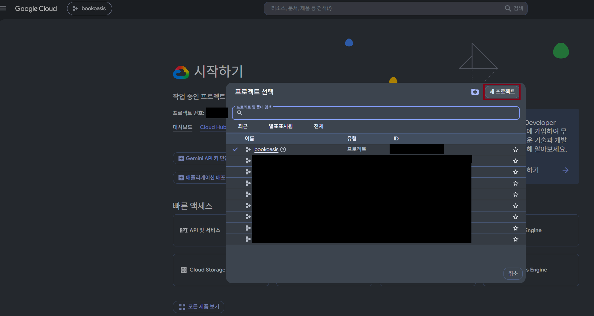
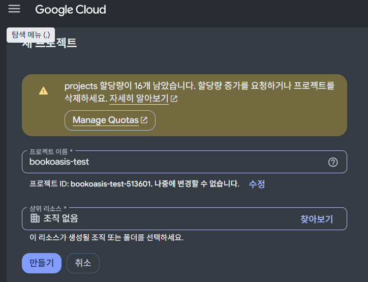
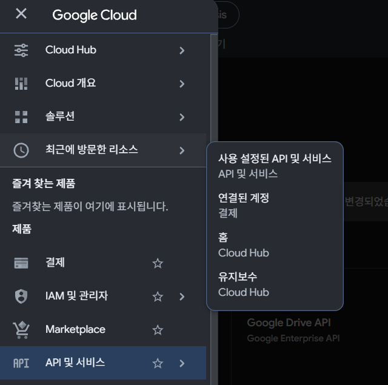
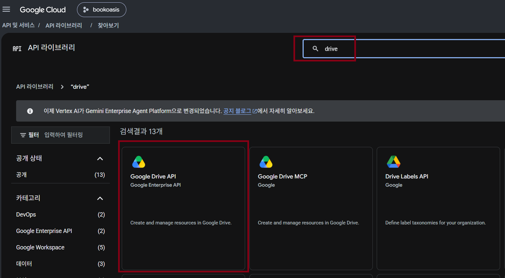

[English](guide_rclone_gdrive_en.md)

# 구글 드라이브 연결하기 (rclone, 화면 없는 서버용)

오라클 서버나 미니 PC처럼 **모니터 없이 SSH로만 쓰는 서버**에 구글 드라이브를 연결해, BookOasis에서 드라이브의 책을 읽는 방법입니다.

순서는 이렇습니다.

1. 구글에 "내 rclone 앱"(client_id)을 만든다 — 한 번만
2. 서버에 rclone을 설치하고 드라이브를 등록한다 (로그인은 **내 PC 브라우저**로)
3. 드라이브를 서버의 폴더로 연결(마운트)한다
4. BookOasis 컨테이너에 그 폴더를 연결한다

> 이 문서의 명령과 결과는 Ubuntu(WSL2) + Docker 29 + rclone 1.75.2에서 직접 따라 하며 확인했습니다 (2026-11-03).
> 아래 예시는 모두 **읽기 전용**입니다. BookOasis는 책을 읽기만 하므로 쓰기 권한이 필요 없습니다.

---

## 1. 내 client_id 만들기 (꼭 필요)

rclone에 기본으로 들어 있던 **공용 client_id는 2026년 중에 동작이 멈춥니다.** rclone 1.75부터는 client_id를 비워 두면 이렇게 경고하고, 기본값(No)을 고르면 진행이 막힙니다.

```
rclone's shared Google Drive client_id is being retired and will stop working during 2026.
Continue using the shared client_id anyway?
```

그래서 지금은 **내 client_id를 만드는 것이 필수**입니다. 구글 계정만 있으면 무료입니다. (10분 정도)

> 이미 공용 client_id로 rclone을 쓰고 있다면 [8. 기존 사용자: 공용 client_id에서 옮기기](#8-기존-사용자-공용-client_id에서-옮기기)를 보세요. 2026년 중 갑자기 드라이브가 끊길 수 있습니다.

**① 새 프로젝트 만들기** — https://console.cloud.google.com/ 에 접속 → 위쪽 프로젝트 이름 → **새 프로젝트**



이름은 아무거나(예: `bookoasis-rclone`) → **만들기**



**② Google Drive API 사용 설정** — 왼쪽 메뉴 **API 및 서비스** → 라이브러리 → `drive` 검색 → **Google Drive API** → **사용**




**③ 동의 화면 만들기** — **API 및 서비스 → OAuth 동의 화면** (화면에 따라 **Google 인증 플랫폼**으로 보입니다) → **시작하기**
- 앱 이름: `rclone` / 지원 이메일: 내 메일
- 대상: **외부(External)**
- 연락처 이메일: 내 메일 → 동의 → **만들기**

**④ 클라이언트 만들기** — **클라이언트 → 클라이언트 만들기**
- 애플리케이션 유형: **데스크톱 앱** ← 꼭 이것. "웹 애플리케이션"으로 만들면 로그인 뒤 돌아올 주소가 맞지 않아 실패합니다.
- **만들기**를 누르면 **클라이언트 ID**와 **클라이언트 보안 비밀번호**가 나옵니다. 창을 닫으면 보안 비밀번호는 다시 볼 수 없으니 메모장에 적어 두세요.

**⑤ 앱 게시 (빠뜨리기 쉬움)** — **대상(Audience) → 앱 게시** → 확인

이 단계를 건너뛰면 앱이 "테스트" 상태로 남아서
- 로그인할 때 **"액세스 차단됨: …Google 인증 절차를 완료하지 않았습니다 (403 오류: access_denied)"** 가 나오거나
- (테스트 사용자로 나를 추가했더라도) **7일마다 다시 로그인**해야 합니다.

구글의 "앱 검토(인증)"는 받지 않아도 됩니다. 나 혼자 쓰는 앱이라 로그인할 때 "확인되지 않은 앱" 경고만 한 번 지나가면 됩니다.

> 클라이언트 ID·보안 비밀번호는 비밀번호처럼 다루세요. 채팅·게시판·스크린샷에 올리지 마세요.

---

## 2. 서버에 rclone 설치

서버(SSH)에서:

```bash
sudo -v ; curl https://rclone.org/install.sh | sudo bash
rclone version
```

`rclone v1.75.x`처럼 버전이 나오면 성공입니다.

내 PC(로그인용)에도 rclone이 필요합니다. https://rclone.org/downloads/ 에서 내 PC에 맞는 파일(Windows는 `rclone-…-windows-amd64.zip`)을 받아 압축만 풀면 됩니다. 설치할 필요는 없습니다. **서버와 같은 버전**을 권장합니다.

---

## 3. 드라이브 등록 (`rclone config`)

서버에서 `rclone config`를 실행하고 아래처럼 답합니다. (`>` 뒤가 입력할 값, 빈칸은 그냥 Enter)

| 질문 | 입력 |
|---|---|
| `e/n/d/r/c/s/q>` | `n` (새 리모트) |
| `name>` | `gdrive` (원하는 이름) |
| `Storage>` | `drive` |
| `client_id>` | 1단계의 **클라이언트 ID** |
| `client_secret>` | 1단계의 **클라이언트 보안 비밀번호** |
| `scope>` | `2` (drive.readonly — 읽기 전용) |
| `service_account_file>` | (Enter) |
| `Edit advanced config?` | `n` |
| `Use web browser to automatically authenticate rclone with remote?` | **`n`** ← 화면 없는 서버이므로 |

그러면 서버 화면에 이런 줄이 나옵니다.

```
Execute the following on the machine with the web browser (same rclone version recommended):
	rclone authorize "drive" "eyJjbGllbnRfaWQiOi..."
Then paste the result.
config_token>
```

**서버 화면은 그대로 두고**, 그 `rclone authorize "drive" "eyJ…"` 줄을 **통째로 복사**해 **내 PC**에서 실행합니다. (긴 `eyJ…` 안에 client_id·보안 비밀번호·읽기 전용 설정이 이미 들어 있어서 따로 입력할 필요가 없습니다.)

Windows 예 (압축 푼 폴더에서 PowerShell):

```powershell
.\rclone.exe authorize "drive" "eyJjbGllbnRfaWQiOi...(서버에 나온 그대로)"
```

브라우저가 열리면
1. 구글 계정으로 로그인
2. **"Google에서 확인하지 않은 앱"** → **고급 → (앱 이름)(으)로 이동(안전하지 않음)** — 내가 만든 앱이라 정상입니다
3. 권한(드라이브 파일 보기) **허용** → 브라우저에 `Success!`

PC 화면에 이렇게 나옵니다.

```
Paste the following into your remote machine --->
eyJ0b2tlbiI6...
<---End paste
```

`--->`와 `<---` **사이의 한 줄**을 복사해 서버의 `config_token>`에 붙여넣습니다. 이어지는 질문은:

| 질문 | 입력 |
|---|---|
| `Configure this as a Shared Drive (Team Drive)?` | `n` (공유 드라이브를 쓸 때만 `y`) |
| `Keep this "gdrive" remote?` | `y` |
| `e/n/d/r/c/s/q>` | `q` |

**확인:**

```bash
rclone lsf gdrive: --max-depth 1
```

내 드라이브의 폴더·파일 이름이 나오면 성공입니다.

---

## 4. 드라이브를 서버 폴더로 연결 (마운트)

BookOasis 컨테이너(Docker)가 이 폴더를 보려면 `--allow-other`가 필요하고, 그러려면 설정 한 줄이 먼저 필요합니다.

```bash
sudo apt install -y fuse3
sudo sh -c 'grep -q "^user_allow_other" /etc/fuse.conf || echo user_allow_other >> /etc/fuse.conf'
mkdir -p ~/gdrive
```

> 이 줄이 없으면 `--allow-other`를 붙인 rclone이 바로 종료되고, `--allow-other` 없이 마운트하면 Docker가 그 폴더를 열지 못해 컨테이너 시작이 실패합니다
> (`error while creating mount source path '/home/…/gdrive': … file exists`). 둘 다 직접 재현했습니다.

**서버가 켜질 때 자동으로 연결되게** systemd 서비스로 등록합니다. `ubuntu`는 내 서버 계정 이름으로 바꾸세요(`whoami`로 확인).

```bash
sudo tee /etc/systemd/system/rclone-gdrive.service > /dev/null <<'EOF'
[Unit]
Description=rclone mount gdrive (read-only)
Wants=network-online.target
After=network-online.target

[Service]
Type=notify
User=ubuntu
ExecStart=/usr/bin/rclone mount gdrive: /home/ubuntu/gdrive --read-only --allow-other --vfs-cache-mode off --dir-cache-time 1h
ExecStop=/bin/fusermount3 -uz /home/ubuntu/gdrive
Restart=on-failure
RestartSec=10

[Install]
WantedBy=multi-user.target
EOF
sudo systemctl daemon-reload
sudo systemctl enable --now rclone-gdrive
ls ~/gdrive | head
```

드라이브의 폴더가 보이면 성공입니다.

> `rclone mount` 옵션(`--read-only --allow-other --vfs-cache-mode off`)은 직접 검증했습니다. systemd 서비스 파일은 표준 형식이며, 서버 환경에 따라 rclone 경로(`which rclone`)만 확인하세요.

---

## 5. BookOasis 컨테이너에 연결

`docker-compose.override.yml`(설치기를 썼다면 설치 폴더에 이미 있음)의 `volumes:`에 아래를 넣습니다. **두 가지가 중요합니다.**

```yaml
services:
  bookoasis:
    volumes:
      - type: bind
        source: /home/ubuntu/gdrive        # 서버의 마운트 폴더
        target: /home/ubuntu/gdrive        # ① 컨테이너 안에서도 같은 경로로
        read_only: true
        bind:
          propagation: rslave              # ② 재부팅 순서가 꼬여도 보이게
```

① **같은 경로로 연결** — BookOasis의 구글 드라이브 기능(스캔 후 새로고침 등)이 서버와 컨테이너에서 같은 경로 문자열을 기대합니다.

② **`propagation: rslave`** — 재부팅 때 Docker가 rclone보다 먼저 뜨면, 일반 연결은 **빈 폴더를 계속 보여 줍니다.** 직접 비교한 결과:

| 상황 | 일반 연결(`- /a:/a:ro`) | `propagation: rslave` |
|---|---|---|
| 컨테이너가 먼저 뜨고 나중에 마운트됨 | **0개 (빈 폴더)** | 정상 |
| 실행 중 rclone이 죽었다가 다시 뜸 | 고장 | **똑같이 고장** → 컨테이너 재시작 필요 |

그래서 rclone 서비스를 재시작했다면 BookOasis도 재시작하세요.

```bash
docker compose up -d          # 설정을 바꾼 뒤 반영
docker restart bookoasis      # rclone을 재시작한 뒤
```

BookOasis에서 카테고리를 추가할 때 경로는 **`/home/ubuntu/gdrive/책폴더`** 처럼 위 경로 아래로 적습니다.

> rclone이 끊기면 BookOasis 알림센터에 "원격 드라이브 연결 끊김" 카드가 뜹니다. 이때 위의 재시작을 하면 됩니다.

---

## 6. (선택) rclone.conf를 컨테이너에 연결

BookOasis 이미지에는 rclone이 이미 들어 있습니다. "구글 드라이브에서 복사해오기" 같은 기능을 쓰려면 rclone 설정 파일을 컨테이너에 연결합니다.

```yaml
    volumes:
      - /home/ubuntu/.config/rclone/rclone.conf:/app/rclone/rclone.conf
```

- `:ro`를 붙이지 마세요 — rclone이 토큰을 갱신하며 파일에 다시 씁니다.
- **복사 기능은 쓰기 권한이 필요**합니다. 3단계에서 읽기 전용(`scope 2`)으로 만든 리모트로는 복사가 실패합니다. 복사 기능이 필요할 때만 쓰기 범위(`scope 1`)로 리모트를 하나 더 만드세요.

---

## 7. 자주 막히는 곳

| 증상 | 원인 → 해결 |
|---|---|
| `client_id> This value is required` | 공용 client_id 폐지 경고에서 No를 고름 → 1단계의 내 client_id를 넣기 |
| 로그인 화면 "액세스 차단됨 … 403 access_denied" | 앱이 테스트 상태 → 1단계 ⑤ **앱 게시** |
| 로그인 후 `redirect_uri_mismatch` | 클라이언트를 "웹 애플리케이션"으로 만듦 → **데스크톱 앱**으로 새로 만들기 |
| 7일마다 다시 로그인해야 함 | 앱이 테스트 상태 → 앱 게시 후 `rclone config reconnect gdrive:` |
| 컨테이너 시작 실패 `error while creating mount source path … file exists` | `--allow-other` 없이 마운트 → 4단계 |
| rclone이 바로 종료(`daemon exited`) | `/etc/fuse.conf`에 `user_allow_other` 없음 → 4단계 |
| 재부팅 후 카테고리가 0권 / 빈 폴더 | 일반 연결 + Docker가 먼저 뜸 → 5단계 `propagation: rslave` |
| `Socket not connected` / `Transport endpoint is not connected` | rclone이 재시작됨 → `docker restart bookoasis` |
| `insufficientPermissions` | 읽기 전용 리모트로 쓰기를 시도 → 정상(BookOasis 스캔은 읽기만 함) |

---

## 8. 기존 사용자: 공용 client_id에서 옮기기

client_id를 비워 둔 채 rclone을 쓰고 있다면(공용 client_id), 2026년 중 드라이브가 끊길 수 있습니다. 미리 옮겨 두세요.

1. 1단계로 내 client_id를 만든다
2. 서버에서 `rclone config` → `e`(편집) → 리모트 선택 → `client_id`, `client_secret`에 새 값 → 나머지는 Enter
3. 토큰을 새로 받겠냐는 질문(rclone 버전에 따라 `Already have a token - refresh?` 등) → `y` → 브라우저 질문 `n` → 3단계처럼 PC에서 `rclone authorize` 후 붙여넣기 (이 편집 흐름은 직접 검증하지 않았습니다)
4. `rclone lsf 리모트이름: --max-depth 1`로 확인 → `sudo systemctl restart rclone-gdrive` → `docker restart bookoasis`

내가 공용 client_id를 쓰는지 확인하려면:

```bash
rclone config show gdrive | grep client_id
```

아무것도 안 나오거나 값이 비어 있으면 공용 client_id입니다.

---

관련 문서: [오라클 무료 서버 설치](guide_install_oracle.md) · [Synology NAS 설치](guide_install_synology.md) · [설치 가이드](guide_installation.md)
