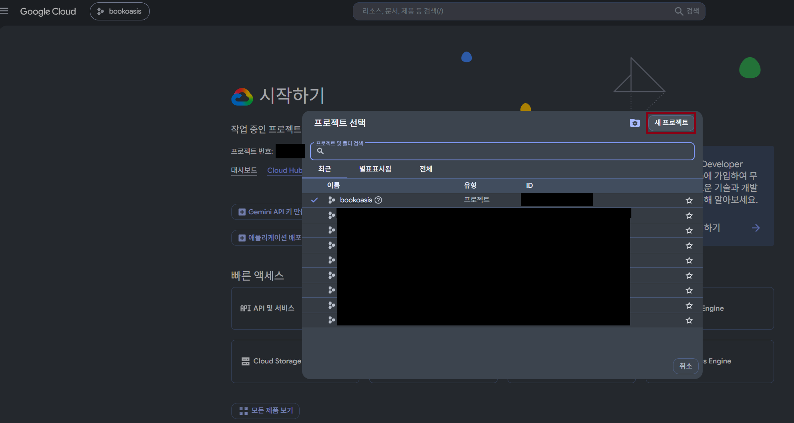
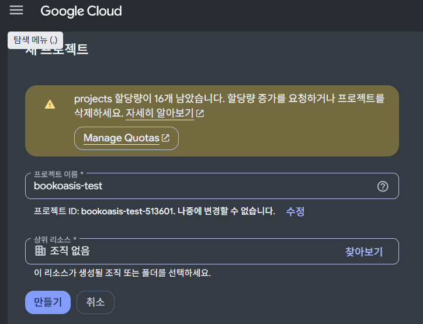
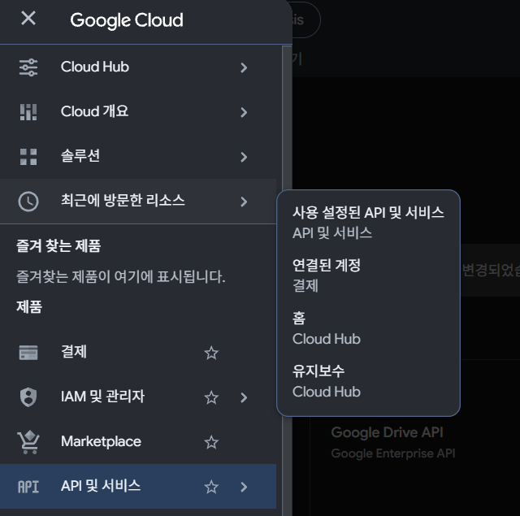
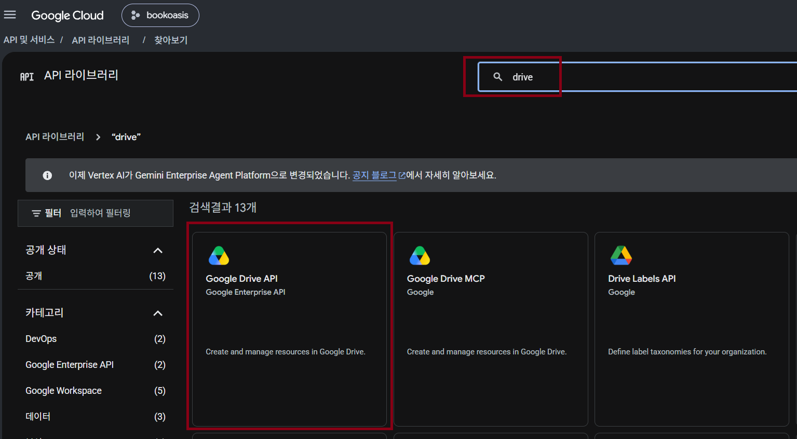

[한국어](guide_rclone_gdrive.md)

# Connecting Google Drive (rclone, for headless servers)

How to connect Google Drive to a server you only reach over SSH (an Oracle Cloud VM, a mini PC without a monitor) so BookOasis can read books from your Drive.

The steps:

1. Create your own rclone "app" (client_id) at Google — once
2. Install rclone on the server and register the drive (sign in with the **browser on your PC**)
3. Mount the drive as a folder on the server
4. Connect that folder to the BookOasis container

> Every command and result here was followed and checked on Ubuntu (WSL2) + Docker 29 + rclone 1.75.2 (2026-11-03).
> All examples are **read-only**. BookOasis only reads books, so it never needs write access.

---

## 1. Create your own client_id (required)

rclone's built-in **shared client_id stops working during 2026.** Since rclone 1.75, leaving client_id empty shows this warning, and the default answer (No) stops the setup:

```
rclone's shared Google Drive client_id is being retired and will stop working during 2026.
Continue using the shared client_id anyway?
```

So creating **your own client_id is now required**. It is free with any Google account (about 10 minutes).

> Already using rclone with the shared client_id? See [8. Existing users: moving off the shared client_id](#8-existing-users-moving-off-the-shared-client_id) — your drive may suddenly disconnect during 2026.

**① New project** — open https://console.cloud.google.com/ → project name at the top → **New project**



Any name (e.g. `bookoasis-rclone`) → **Create**



**② Enable the Google Drive API** — left menu **APIs & Services** → Library → search `drive` → **Google Drive API** → **Enable**




**③ Consent screen** — **APIs & Services → OAuth consent screen** (may appear as **Google Auth Platform**) → **Get started**
- App name: `rclone` / support email: yours
- Audience: **External**
- Contact email: yours → agree → **Create**

**④ Client** — **Clients → Create client**
- Application type: **Desktop app** ← must be this. A "Web application" client fails because the redirect address after sign-in does not match.
- **Create** shows the **Client ID** and **Client secret**. The secret cannot be viewed again after closing the dialog — write both down.

**⑤ Publish the app (easy to miss)** — **Audience → Publish app** → confirm

If you skip this, the app stays in "Testing", and
- sign-in fails with **"Access blocked: … has not completed the Google verification process (Error 403: access_denied)"**, or
- (even if you add yourself as a test user) you must **sign in again every 7 days**.

You do not need Google's app verification. It is your own app; you only click past the "unverified app" warning once.

> Treat the client ID and secret like a password. Do not post them in chats, forums or screenshots.

---

## 2. Install rclone on the server

On the server (SSH):

```bash
sudo -v ; curl https://rclone.org/install.sh | sudo bash
rclone version
```

Success: a version such as `rclone v1.75.x`.

Your PC (used for sign-in) also needs rclone. Download the file for your PC from https://rclone.org/downloads/ (Windows: `rclone-…-windows-amd64.zip`) and just unzip it; no install needed. **Same version as the server** is recommended.

---

## 3. Register the drive (`rclone config`)

Run `rclone config` on the server and answer as below (value after `>`; blank = just Enter).

| Prompt | Enter |
|---|---|
| `e/n/d/r/c/s/q>` | `n` (new remote) |
| `name>` | `gdrive` (any name) |
| `Storage>` | `drive` |
| `client_id>` | your **Client ID** from step 1 |
| `client_secret>` | your **Client secret** from step 1 |
| `scope>` | `2` (drive.readonly — read-only) |
| `service_account_file>` | (Enter) |
| `Edit advanced config?` | `n` |
| `Use web browser to automatically authenticate rclone with remote?` | **`n`** ← the server has no browser |

The server then shows:

```
Execute the following on the machine with the web browser (same rclone version recommended):
	rclone authorize "drive" "eyJjbGllbnRfaWQiOi..."
Then paste the result.
config_token>
```

**Leave the server waiting**, copy that whole `rclone authorize "drive" "eyJ…"` line and run it **on your PC**. (The long `eyJ…` already contains your client_id, secret and the read-only scope, so you type nothing else.)

Windows example (PowerShell, in the unzipped folder):

```powershell
.\rclone.exe authorize "drive" "eyJjbGllbnRfaWQiOi...(exactly as shown on the server)"
```

A browser opens:
1. Sign in with your Google account
2. **"Google hasn't verified this app"** → **Advanced → Go to (app name) (unsafe)** — expected, it is your own app
3. **Allow** the permission (see Drive files) → the browser shows `Success!`

Your PC prints:

```
Paste the following into your remote machine --->
eyJ0b2tlbiI6...
<---End paste
```

Copy **the single line between** `--->` and `<---` and paste it at the server's `config_token>`. Then:

| Prompt | Enter |
|---|---|
| `Configure this as a Shared Drive (Team Drive)?` | `n` (`y` only for a shared drive) |
| `Keep this "gdrive" remote?` | `y` |
| `e/n/d/r/c/s/q>` | `q` |

**Check:**

```bash
rclone lsf gdrive: --max-depth 1
```

Success: your Drive's folder and file names are listed.

---

## 4. Mount the drive as a server folder

For the BookOasis container (Docker) to see the folder you need `--allow-other`, which first needs one setting:

```bash
sudo apt install -y fuse3
sudo sh -c 'grep -q "^user_allow_other" /etc/fuse.conf || echo user_allow_other >> /etc/fuse.conf'
mkdir -p ~/gdrive
```

> Without that line, rclone with `--allow-other` exits immediately; without `--allow-other`, Docker cannot open the folder and the container fails to start
> (`error while creating mount source path '/home/…/gdrive': … file exists`). Both reproduced.

Register a systemd service so it **mounts automatically at boot**. Replace `ubuntu` with your server user (`whoami`).

```bash
sudo tee /etc/systemd/system/rclone-gdrive.service > /dev/null <<'EOF'
[Unit]
Description=rclone mount gdrive (read-only)
Wants=network-online.target
After=network-online.target

[Service]
Type=notify
User=ubuntu
ExecStart=/usr/bin/rclone mount gdrive: /home/ubuntu/gdrive --read-only --allow-other --vfs-cache-mode off --dir-cache-time 1h
ExecStop=/bin/fusermount3 -uz /home/ubuntu/gdrive
Restart=on-failure
RestartSec=10

[Install]
WantedBy=multi-user.target
EOF
sudo systemctl daemon-reload
sudo systemctl enable --now rclone-gdrive
ls ~/gdrive | head
```

Success: your Drive folders are listed.

> The `rclone mount` options (`--read-only --allow-other --vfs-cache-mode off`) were verified directly. The systemd unit is a standard form; just check the rclone path for your server (`which rclone`).

---

## 5. Connect it to the BookOasis container

Add this under `volumes:` in `docker-compose.override.yml` (the installer already created it in the install folder). **Two things matter.**

```yaml
services:
  bookoasis:
    volumes:
      - type: bind
        source: /home/ubuntu/gdrive        # mount folder on the server
        target: /home/ubuntu/gdrive        # ① same path inside the container
        read_only: true
        bind:
          propagation: rslave              # ② still visible if boot order goes wrong
```

① **Same path** — BookOasis's Google Drive features (refresh after scan, etc.) expect the same path string on the server and in the container.

② **`propagation: rslave`** — if Docker starts before rclone at boot, a plain bind keeps showing **an empty folder**. Measured side by side:

| Situation | Plain bind (`- /a:/a:ro`) | `propagation: rslave` |
|---|---|---|
| Container starts first, mount comes later | **0 items (empty)** | OK |
| rclone dies while running and comes back | broken | **also broken** → restart the container |

So whenever you restart the rclone service, restart BookOasis too:

```bash
docker compose up -d          # after changing the settings
docker restart bookoasis      # after restarting rclone
```

When adding a category in BookOasis, use a path under it, e.g. **`/home/ubuntu/gdrive/BookFolder`**.

> If rclone disconnects, BookOasis shows a "remote drive unavailable" card in the notification center. Restart as above.

---

## 6. (Optional) Connect rclone.conf to the container

The BookOasis image already contains rclone. For features such as "Copy from Google Drive", connect your rclone config file:

```yaml
    volumes:
      - /home/ubuntu/.config/rclone/rclone.conf:/app/rclone/rclone.conf
```

- Do not add `:ro` — rclone writes refreshed tokens back to the file.
- **Copying needs write access.** The read-only remote from step 3 (`scope 2`) cannot copy. Create a second remote with full scope (`scope 1`) only if you need copying.

---

## 7. Common problems

| Symptom | Cause → fix |
|---|---|
| `client_id> This value is required` | answered No to the shared client_id warning → enter your client_id from step 1 |
| Sign-in shows "Access blocked … 403 access_denied" | app is in Testing → step 1 ⑤ **Publish app** |
| `redirect_uri_mismatch` after sign-in | client created as "Web application" → create a **Desktop app** client |
| Must sign in again every 7 days | app is in Testing → publish, then `rclone config reconnect gdrive:` |
| Container fails: `error while creating mount source path … file exists` | mounted without `--allow-other` → step 4 |
| rclone exits immediately (`daemon exited`) | `user_allow_other` missing in `/etc/fuse.conf` → step 4 |
| Empty folder / 0 books after reboot | plain bind + Docker started first → step 5 `propagation: rslave` |
| `Socket not connected` / `Transport endpoint is not connected` | rclone restarted → `docker restart bookoasis` |
| `insufficientPermissions` | write attempted on a read-only remote → expected (BookOasis scanning only reads) |

---

## 8. Existing users: moving off the shared client_id

If you use rclone with an empty client_id (the shared one), your drive may disconnect during 2026. Move now:

1. Create your own client_id (step 1)
2. On the server: `rclone config` → `e` (edit) → pick the remote → enter the new `client_id` and `client_secret` → Enter for the rest
3. When asked whether to get a new token (wording varies by version, e.g. `Already have a token - refresh?`) → `y` → browser question `n` → run `rclone authorize` on your PC and paste, as in step 3 (this edit flow was not verified directly)
4. Check with `rclone lsf REMOTE: --max-depth 1` → `sudo systemctl restart rclone-gdrive` → `docker restart bookoasis`

To see whether you use the shared client_id:

```bash
rclone config show gdrive | grep client_id
```

Nothing printed, or an empty value, means the shared client_id.

---

Related: [Oracle free server install](guide_install_oracle_en.md) · [Synology NAS install](guide_install_synology_en.md) · [Installation guide](guide_installation_en.md)
