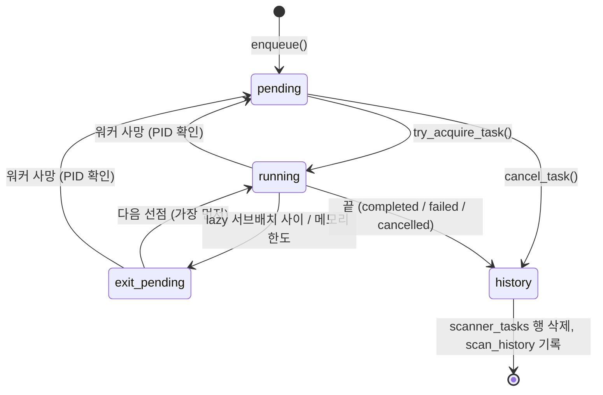

# 📐 스캐너 큐 및 라이브러리 스캔 상태 전이 명세서 (Specification)

스캐너 워커(별도 프로세스)가 처리하는 작업 대기열 `scanner_tasks`와, 카테고리별 스캔 상태 `libraries.scan_status`가 언제 어떻게 바뀌는지 정리합니다. 큐는 **한 번에 작업 하나만** 실행합니다. 전체 구조는 [guide_architecture.md](./guide_architecture.md) 6절을 먼저 보세요.

---

## 1. 작업 종류 (`scanner_tasks.task_type`)

`services/scanner_queue.py`의 워커 루프가 종류별 처리 함수로 나눠 보냅니다. `task_key`가 같은 작업은 대기·실행 중일 때 다시 넣지 않습니다(`force_requeue`면 다시 대기).

| 종류 | `task_key` | 처리 함수 | 내용 |
| :--- | :--- | :--- | :--- |
| `library_scan` | `library_scan_{db}_{id}` | `_process_library_scan` | 카테고리 전체 스캔 (`scheduler_service.run_scan_job` → `tools/scanner/core.scan_library`) |
| `batch_book_scan` | `batch_book_scan_{db}_{hash}` | `_process_batch_book_scan` | 여러 권 선택 재스캔 |
| `cover_scan` | `cover_scan_{db}_{id}` | `_process_cover_scan` | 표지만 다시 만들기 |
| `lazy_scan` | `lazy_scan` | `_process_lazy_scan` | lazy 스캐너(표지 보정·영상 ffprobe 등)를 자식 프로세스로 서브배치 반복 실행 |
| `gdrive_copy` | `gdrive_copy_{db}_{경로}` | `_process_gdrive_copy` | 구글 드라이브 → 로컬 복사 |
| `library_delete` | `library_delete_{db}_{id}` | `_process_library_delete` | 카테고리 데이터를 나눠서 삭제 |
| `library_transfer` | `library_transfer_{db}_{id}` | `_process_library_transfer` | 카테고리를 다른 세션 DB로 이동 |

다음 작업 고르는 순서(`get_next_pending_task`): `exit_pending` 먼저 → `lazy_scan`이 아닌 작업 → `id` 순. Redis가 있으면 `queue:scanner` BRPOP으로 깨어나고, 없으면 3초마다 DB를 봅니다.

---

## 2. 작업 상태 (`scanner_tasks.status`)

**끝난 작업은 이 표에 남지 않습니다.** 완료·실패·취소는 `scan_history`에 한 줄로 옮긴 뒤 `scanner_tasks`에서 지웁니다(`update_task_result`, `mark_task_cancelled`, `cancel_task`). `scan_history`는 90일이 지나면 서버 시작 때 정리됩니다.

| 상태 | 의미 | 들어오는 경우 | 나가는 경우 |
| :--- | :--- | :--- | :--- |
| `pending` | 대기 | `enqueue()`; 죽은 워커가 잡고 있던 작업의 복구 | 워커가 선점 → `running`; 취소 → 이력(`cancelled`) |
| `running` | 실행 중 (`worker_pid` 기록) | `try_acquire_task()`의 조건부 UPDATE | 끝 → 이력(`completed`/`failed`/`cancelled`); 워커 사망 → `pending` |
| `exit_pending` | 잠깐 멈췄다 이어 갈 작업 | lazy 서브배치 사이(RAM 환수 코드 10, 2시간 한도); 라이브러리 스캔 중 메모리 한도 초과(엔진이 표시하고 워커를 `os.execv`로 다시 띄움) | 다음 선점 때 가장 먼저 → `running` |
| (이력) `completed` / `failed` / `cancelled` | 끝 | 워커 루프의 `finally`가 반드시 기록 | — |

### 선점 규칙 (`try_acquire_task`)
- `UPDATE ... SET status='running' WHERE id=? AND status IN ('pending','exit_pending')` — 조건부라 두 워커가 같은 작업을 잡지 못합니다.
- 다른 `running` 작업이 있으면: 그 PID가 살아 있으면 선점하지 않고, 죽었으면 그 작업을 `pending`으로 돌리고 선점합니다.

### 취소 (세 갈래)
| 대상 | 화면/API | 기록 | 결과 |
| :--- | :--- | :--- | :--- |
| 대기 중 작업 | 큐 화면 "취소" → `/api/media/system/queue/cancel` | `cancel_task()` | 이력 `cancelled`, 행 삭제 |
| 실행 중 카테고리 스캔 | 중단 버튼 → `/api/media/libraries/<id>/cancel-scan` | 그 카테고리 DB의 `libraries.scan_status='cancelling'` | 엔진이 폴더 3개마다 확인 → 지금까지 저장 후 `ready`로 되돌리고 반환. 작업은 정상 반환이라 이력에는 `completed`로 남는다 |
| 실행 중 lazy·Drive 복사 | 큐 화면 "중지" → `cancel_running_task()` | `scanner_tasks.cancel_requested=1` | lazy는 2초마다 확인해 자식 프로세스 종료, Drive 복사는 파일 사이에서 확인 → `ScanCancelledError` → 이력 `cancelled` |

엔진은 카테고리 상태 외에 `scanner_tasks`의 같은 키 `status='cancelled'`도 취소로 봅니다. 카테고리 상태는 **그 카테고리가 속한 DB**에서 읽습니다(`tests/test_scan_cancel_db_type.py`).

---

## 3. 카테고리 상태 (`libraries.scan_status`)

| 상태 | 의미 | 들어오는 경우 | 나가는 경우 |
| :--- | :--- | :--- | :--- |
| `ready` | 쉬는 중 | 스캔 성공(`update_library_scan_success`, `last_scanned_at` 기록); 취소 처리 끝; 자동 재개 직전 | 스캔 시작 → `scanning` |
| `scanning` | 스캔 중 | `run_scan_job`이 VFS 새로고침 전에 기록 | 성공 → `ready`; 예외 → `failed`; 중단 요청 → `cancelling`; 워커 사망 → `interrupted` |
| `cancelling` | 중단 요청됨 | 중단 버튼 | 엔진이 감지 → `ready` |
| `failed` | 마지막 스캔 실패 | 재시도 끝에도 예외 | 다음 스캔 → `scanning` |
| `interrupted` | 워커가 죽어 스캔이 끊김 | 워커 시작 때 `startup_cleanup_ghost_tasks()`가 `scanning` → `interrupted` | 웹 스케줄러 시작 때 `auto_resume_interrupted_jobs()`가 `ready`로 바꾸고 다시 넣음 |

카테고리 상태가 실제 작업과 어긋나 남았을 때는 `tools/repair_scan_status.py`로 정리합니다.

---

## 4. 상태 전이도

---

## 5. 구현 규칙

1. **끝 처리는 반드시 `finally`에서**: 처리 함수에서 예외가 나도 워커 루프의 `finally`가 `update_task_result()` 또는 `mark_task_cancelled()`를 부릅니다. 새 작업 종류도 이 루프 안에서 실행하세요.
2. **무거운 후속 작업은 스캔 스레드 밖에서**: 새 도서 웹훅·플러그인 훅은 데몬 스레드로 넘겨 스캔 반환을 붙잡지 않습니다.
3. **선점은 조건부 UPDATE 한 번**: 상태 확인과 변경을 따로 하지 않습니다(2절 선점 규칙).
4. **죽으면 이어서 한다**: `running`/`exit_pending`인데 PID가 죽은 작업은 워커 시작 때(`startup_cleanup_ghost_tasks`)와 5분마다(`cleanup_stale_tasks`) `pending`으로 돌아갑니다. 카테고리는 `interrupted` → `auto_resume_interrupted_jobs()`(4개 DB 모두)로 다시 들어갑니다. 이미 저장된 폴더는 수정 시각으로 건너뛰므로 처음부터 다시 하는 비용이 작습니다.
5. **워커에 종료 신호 처리기를 붙이지 않는다**: 워커는 SIGTERM에 바로 끝나고 규칙 4로 복구합니다. 엔진의 `stop_requested`로 "멈추고 마무리"하게 바꾸면 남은 폴더를 두고 작업이 '완료'로 기록되어 이어 하기가 사라집니다([guide_architecture.md](./guide_architecture.md) 3절).
6. **새 작업 종류를 만들 때**: `_get_task_key`에 키 규칙, 워커 루프에 처리 함수, 필요하면 취소 확인(`is_cancel_requested`)을 넣고, 오래 걸리면 `update_task_stage()`로 진행 단계를 남기세요.
