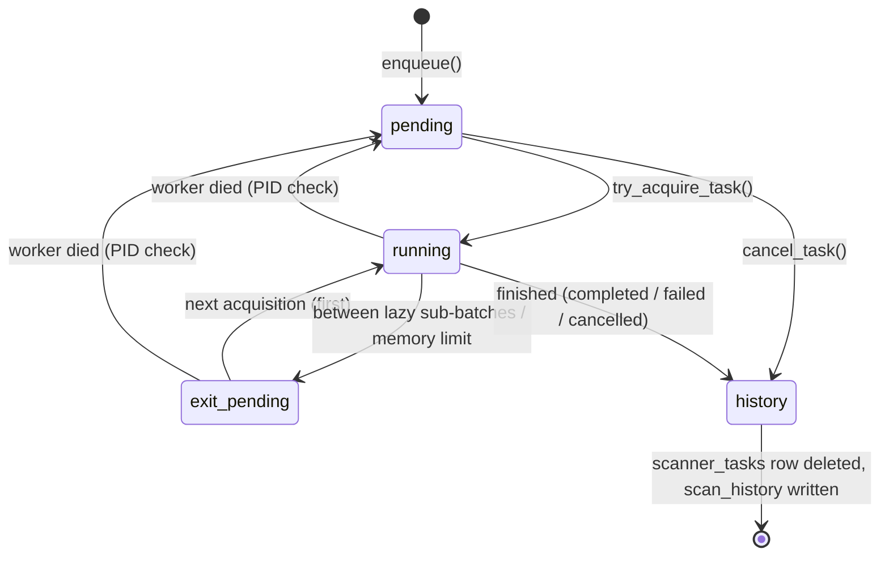

# 📐 Scanner Queue and Library Scan State Transition Specification

This document describes when and how the task queue `scanner_tasks` (processed by the scanner worker, a separate process) and the per-category scan state `libraries.scan_status` change. The queue runs **one task at a time**. Read section 6 of [guide_architecture_en.md](./guide_architecture_en.md) first for the overall structure.

---

## 1. Task types (`scanner_tasks.task_type`)

The worker loop in `services/scanner_queue.py` dispatches each type to its handler. A task whose `task_key` is already pending or running is not queued again (with `force_requeue` it goes back to pending).

| Type | `task_key` | Handler | What it does |
| :--- | :--- | :--- | :--- |
| `library_scan` | `library_scan_{db}_{id}` | `_process_library_scan` | Full category scan (`scheduler_service.run_scan_job` → `tools/scanner/core.scan_library`) |
| `batch_book_scan` | `batch_book_scan_{db}_{hash}` | `_process_batch_book_scan` | Rescan of several selected books |
| `cover_scan` | `cover_scan_{db}_{id}` | `_process_cover_scan` | Regenerate covers only |
| `lazy_scan` | `lazy_scan` | `_process_lazy_scan` | Runs the lazy scanner (cover fixes, video ffprobe, etc.) as a child process in repeated sub-batches |
| `gdrive_copy` | `gdrive_copy_{db}_{path}` | `_process_gdrive_copy` | Copy from Google Drive to local storage |
| `library_delete` | `library_delete_{db}_{id}` | `_process_library_delete` | Delete a category's data in chunks |
| `library_transfer` | `library_transfer_{db}_{id}` | `_process_library_transfer` | Move a category to another session DB |

Order for picking the next task (`get_next_pending_task`): `exit_pending` first → tasks other than `lazy_scan` → by `id`. With Redis the worker wakes on a `queue:scanner` BRPOP; without it the worker polls the DB every 3 seconds.

---

## 2. Task states (`scanner_tasks.status`)

**Finished tasks do not stay in this table.** Completed, failed and cancelled tasks are written to `scan_history` as one row and then deleted from `scanner_tasks` (`update_task_result`, `mark_task_cancelled`, `cancel_task`). `scan_history` rows older than 90 days are purged at server start.

| State | Meaning | Enters when | Leaves when |
| :--- | :--- | :--- | :--- |
| `pending` | Waiting | `enqueue()`; recovery of a task held by a dead worker | The worker acquires it → `running`; cancelled → history (`cancelled`) |
| `running` | Running (`worker_pid` recorded) | The conditional UPDATE in `try_acquire_task()` | Finishes → history (`completed`/`failed`/`cancelled`); worker dies → `pending` |
| `exit_pending` | Paused, will continue | Between lazy sub-batches (RAM recovery exit code 10, 2-hour limit); a library scan hitting the memory limit (the engine marks it and restarts the worker with `os.execv`) | Picked first at the next acquisition → `running` |
| (history) `completed` / `failed` / `cancelled` | Finished | Always written by the worker loop's `finally` | — |

### Acquisition rules (`try_acquire_task`)
- `UPDATE ... SET status='running' WHERE id=? AND status IN ('pending','exit_pending')`. Because it is conditional, two workers cannot take the same task.
- If another task is `running`: if its PID is alive the worker does not acquire; if it is dead, that task goes back to `pending` and the worker acquires.

### Cancellation (three paths)
| Target | UI/API | Recorded as | Result |
| :--- | :--- | :--- | :--- |
| A waiting task | Queue screen "Cancel" → `/api/media/system/queue/cancel` | `cancel_task()` | History `cancelled`, row deleted |
| A running category scan | Stop button → `/api/media/libraries/<id>/cancel-scan` | `libraries.scan_status='cancelling'` in that category's DB | The engine checks every 3 folders → saves what it has, sets `ready` and returns. The task returns normally, so history records it as `completed` |
| A running lazy scan or Drive copy | Queue screen "Stop" → `cancel_running_task()` | `scanner_tasks.cancel_requested=1` | Lazy checks every 2 seconds and stops its child process; Drive copy checks between files → `ScanCancelledError` → history `cancelled` |

Besides the category state, the engine also treats `status='cancelled'` on the same key in `scanner_tasks` as a cancel. The category state is read from **the DB that category belongs to** (`tests/test_scan_cancel_db_type.py`).

---

## 3. Category states (`libraries.scan_status`)

| State | Meaning | Enters when | Leaves when |
| :--- | :--- | :--- | :--- |
| `ready` | Idle | Scan succeeded (`update_library_scan_success`, records `last_scanned_at`); a cancel was handled; right before auto-resume | A scan starts → `scanning` |
| `scanning` | Scanning | Written by `run_scan_job` before the VFS refresh | Success → `ready`; exception → `failed`; stop requested → `cancelling`; worker dies → `interrupted` |
| `cancelling` | Stop requested | Stop button | The engine notices → `ready` |
| `failed` | Last scan failed | An exception after the retries | Next scan → `scanning` |
| `interrupted` | Scan cut off by a dead worker | At worker start `startup_cleanup_ghost_tasks()` turns `scanning` → `interrupted` | At web scheduler start `auto_resume_interrupted_jobs()` sets `ready` and queues it again |

If a category state is left out of sync with the real tasks, clean it up with `tools/repair_scan_status.py`.

---

## 4. State diagram

---

## 5. Implementation rules

1. **Always finish in `finally`**: even if a handler raises, the worker loop's `finally` calls `update_task_result()` or `mark_task_cancelled()`. Run new task types inside this loop too.
2. **Keep heavy follow-up work off the scan thread**: new-book webhooks and plugin hooks are handed to daemon threads so they don't hold up the scan's return.
3. **Acquire with one conditional UPDATE**: do not check the state and change it in separate steps (acquisition rules in section 2).
4. **Resume after a crash**: tasks in `running`/`exit_pending` whose PID is dead go back to `pending` at worker start (`startup_cleanup_ghost_tasks`) and every 5 minutes (`cleanup_stale_tasks`). Categories go through `interrupted` → `auto_resume_interrupted_jobs()` (all 4 DBs). Folders already saved are skipped by modification time, so starting over is cheap.
5. **Do not give the worker a shutdown signal handler**: the worker ends at once on SIGTERM and recovers through rule 4. Making it "stop and wrap up" through the engine's `stop_requested` would record the task as completed with folders left over, and the resume would be lost (section 3 of [guide_architecture_en.md](./guide_architecture_en.md)).
6. **When you add a task type**: add the key rule to `_get_task_key`, the handler to the worker loop, a cancel check (`is_cancel_requested`) if needed, and record progress with `update_task_stage()` if it runs long.
